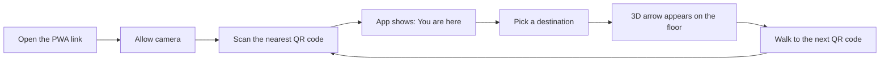
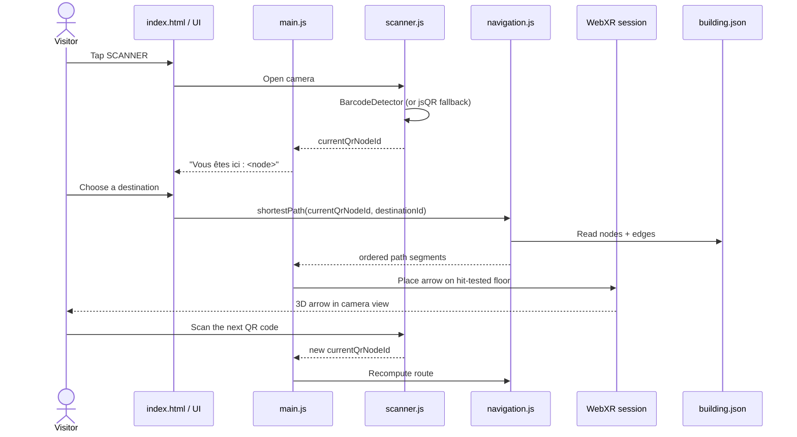
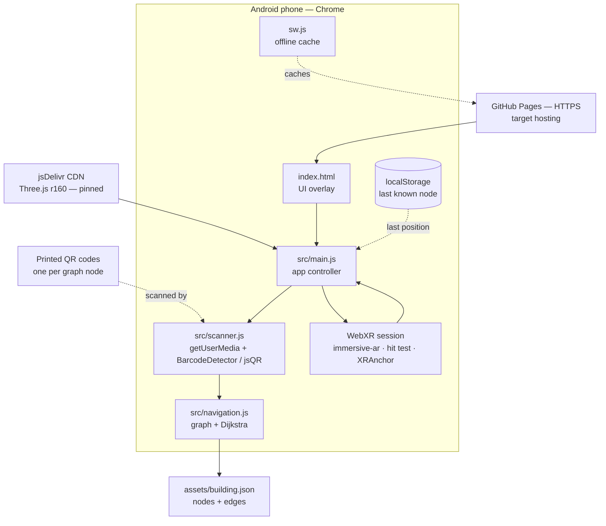

# Indoor Wayfinder

> **AR indoor navigation, in the browser.** Scan a QR code on the wall, pick a room, and follow a 3D arrow drawn on the floor through your phone camera.

**SUP'COM — Département SIA** · Project 2: *WebXR AR & Spatial Computing* · 6-week MVP

| | |
|---|---|
| **Team** | Yassine Mhiri · Oussema Harrabi · Amin Jarbaoui |
| **Supervisor** | Mohamed Bécha Kaaniche |
| **Brief** | Cahier des charges v1.0 — 24 October 2026 |
| **App version** | `v1.1.0` (commit `c3308e4`) |
| **Sprint** | 1 of 6 — PWA shell + 3D scene |
| **Last updated** | 2026-11-05 |

---

## Table of contents

1. [The project in one minute](#the-project-in-one-minute)
2. [The problem](#the-problem)
3. [How it works](#how-it-works)
4. [What is already built](#what-is-already-built)
5. [What is not built yet](#what-is-not-built-yet)
6. [Project status](#project-status)
7. [Architecture](#architecture)
8. [Technology stack](#technology-stack)
9. [Repository layout](#repository-layout)
10. [Run it locally](#run-it-locally)
11. [Deployment](#deployment)
12. [Building data model](#building-data-model)
13. [Roadmap — the remaining five sprints](#roadmap--the-remaining-five-sprints)
14. [Design patterns](#design-patterns)
15. [Coding conventions](#coding-conventions)
16. [Deliverables checklist](#deliverables-checklist)
17. [Demo scenario](#demo-scenario)
18. [Testing environment](#testing-environment)
19. [Risks and mitigations](#risks-and-mitigations)
20. [Out of scope](#out-of-scope)
21. [FAQ](#faq)
22. [Team](#team)

---

## The project in one minute

Large buildings are hard to navigate. Wall maps are static, GPS does not work indoors, and installing a native app just to find a room is too much friction.

**Indoor Wayfinder is a Progressive Web App (PWA)** that turns an Android phone into an indoor GPS:

1. The visitor opens a **web link** — nothing to install.
2. They **scan a QR code** posted in the corridor, so the app knows which point of the building they are standing at.
3. They **choose a destination** (room, amphitheatre, exit).
4. The app computes the **shortest path** through the building graph.
5. Through the camera, a **3D arrow appears on the floor** and points the way (WebXR augmented reality).
6. At the next QR code, the visitor scans again and the route updates.

The whole stack is **client-side only**: static files on GitHub Pages, Three.js from a pinned jsDelivr CDN, a JSON floor plan, and the phone's camera. No server, no beacons, no budget.

---

## The problem

> *How can a visitor know where they are inside a building and follow a route displayed in their real environment, without installing an app and without expensive infrastructure (Bluetooth beacons, sensor networks)?*

Constraints imposed by the course:

- **6 weeks**, one sprint per week, demo every week.
- **No budget and no dedicated hardware**.
- Target: **Android smartphone** (Chrome) or a **desktop emulator**.
- **HTTPS is mandatory** for camera access, WebXR and the Service Worker.
- The building plan is entered **manually** as a graph; no automatic mapping.
- **No GPS indoors**; localization relies only on QR codes.
- **One floor** in the first version (no stairs/elevators in routing).

Target users: students, newcomers, visitors and exam candidates; secondary users: building administrations that want complementary signage; evaluators: the jury and teachers.

---

## How it works

### User journey



### Technical flow



**Important:** the position is **not continuous**. It is updated only when a QR code is scanned. Between two codes, the app keeps the last known node and the arrow guides toward the next waypoint. This is a deliberate design choice from the brief, not a bug.

---

## What is already built

Sprint 1 delivered a working **PWA shell and a Three.js 3D scene** (v1.1.0, 4 November 2026).

### 1. Mobile-first PWA shell — `index.html`

- French UI, dark glassmorphism design system built with CSS custom properties.
- Responsive layout with safe-area handling for notched phones.
- Header with the app brand and a live **online/offline badge**.
- Discreet auto-dismissing **status toast**.
- Floating bottom action bar with two actions: **SCANNER** and **DESTINATION**.
- **Scan overlay mockup**: viewfinder corners, animated laser sweep line, guidance text.
- **Destination bottom sheet**: six hard-coded rooms, live text search, swipe-down-to-dismiss, Escape/backdrop close, keyboard support.
- Accessibility touches: ARIA roles, focus states, `prefers-reduced-motion` support.
- `manifest.json` with app name, colours, orientation, start URL and icon declarations.

### 2. Three.js scene — `src/main.js`

- Three.js **r160** loaded from **jsDelivr** through an ES module import map (version pinned).
- Dark scene with exponential fog and a ground grid that fades into the horizon.
- Rotating **cube with visible edges** — a deliberate Week 1 placeholder for the navigation arrow.
- Procedural radial ground glow, ambient + directional lighting (2 lights, mobile-friendly).
- Render loop with floating/rotation animation, disabled under `prefers-reduced-motion`.
- Resize and orientation-change handling; pixel ratio capped at 2.
- `createArrow()` is already written but **not called**: it is the reserved 3D waypoint arrow (cylinder + cone) for the WebXR sprint.
- Application state placeholders: `currentQrNodeId`, `currentDestinationId`.
- Destination selection currently only stores the ID and shows a toast.

### 3. What was verified (2026-11-05)

- Page loads with no JavaScript errors.
- The Three.js canvas renders (`Three.js r160` confirmed in the console).
- The scan overlay opens and closes.
- Destination search filters the list; selecting a room updates the toast.
- The online/offline badge reflects `navigator.onLine`.
- Missing icon requests are the only failing requests (`assets/icons/icon-192.png`).

---

## What is not built yet

This is the honest state of the repository as of **2026-11-05**:

| Area | Status | Notes |
|---|---|---|
| PWA shell and design system | ✅ Done | `index.html` |
| Three.js scene | ✅ Done | Rotating cube placeholder |
| Online/offline indicator | ✅ Done | `navigator.onLine` |
| Scan overlay | 🟡 Mockup | No camera, no QR decoding |
| Destination sheet and search | 🟡 Mockup | Hard-coded rooms; no graph, no real distances |
| QR localization | ⬜ Not started | `src/scanner.js` does not exist |
| Building graph + shortest path | ⬜ Not started | `src/navigation.js` and `assets/building.json` do not exist |
| WebXR `immersive-ar` + hit testing | ⬜ Not started | No XR session yet |
| 3D arrow in AR | 🟡 Reserved | `createArrow()` exists but is never called |
| Route updates after each scan | ⬜ Not started | — |
| Arrival vibration / wake lock | ⬜ Not started | Planned Sprint 5 |
| Service Worker / offline | ⬜ Not started | `sw.js` does not exist |
| PWA installability | ⬜ Blocked | Icons are referenced but missing; no Service Worker |
| GitHub Pages deployment | ⬜ Not enabled | `https://yessinomhiri-cpu.github.io/indoor-wayfinder/` returns 404 |
| Technical documentation / user manual | ⬜ Not started | `/docs` does not exist |
| Demo video | ⬜ Not started | Deliverable for Sprint 6 |
| Tests | ⬜ Not started | No test suite; manual smoke tests only |

### Known issues

1. **Missing icons.** `index.html` and `manifest.json` reference `assets/icons/icon-192.png` and `assets/icons/icon-512.png`, but the `assets/` directory does not exist. This produces 404s and prevents installation.
2. **No Service Worker.** Even with icons, the app is not installable/offline until `sw.js` is registered.
3. **The destination distances are fake.** Values such as "25 m" are static HTML, not computed from a graph.
4. **The scanner is a visual mockup.** There is no `getUserMedia` call and no barcode decoding yet.
5. **The 3D cube is not the navigation arrow.** It is the Week 1 proof that Three.js loads and renders.
6. **No HTTPS demo yet.** GitHub Pages is not enabled, so camera and WebXR cannot be tested from a public URL.
7. **No Android/ARCore test is documented.** The repository contains no test notes or device results; only desktop rendering has been checked.

---

## Project status

| Sprint | Goal | Expected deliverable | Status |
|---|---|---|---|
| **1** | PWA structure, Three.js scene via jsDelivr, ES6 modules | A page that displays a 3D scene | ✅ **Done** |
| **2** | QR code reading (Device API), position identification | "Vous êtes ici" | ⬜ Next |
| **3** | Building graph, shortest path computation | Route displayed as text | ⬜ |
| **4** | `immersive-ar` session, hit testing, arrow placement | 3D arrow anchored to the floor | ⬜ |
| **5** | Route update on each QR scan, destination choice | Complete journey on one floor | ⬜ |
| **6** | Service Worker (offline), optimization, tests, docs, video | Final mobile version | ⬜ |

**Progress: 1 of 6 sprints complete (≈17%).** The visual foundation is in place; the functional core (camera, graph, AR) is still to be built.

---

## Architecture

Everything runs **client-side**: no backend, no database, no user accounts, no personal data.



**Reading the diagram:** solid arrows exist or are directly planned; dotted arrows are planned integrations. `scanner.js`, `navigation.js`, `sw.js`, `building.json` and the AR session are **not implemented yet**.

### Why this architecture

- **No install, no store:** a URL is enough; GitHub Pages provides HTTPS for free.
- **No infrastructure:** QR codes are printed paper, not powered beacons.
- **Works on low-end devices:** Three.js scene kept lightweight (2 lights, capped pixel ratio, procedural geometry).
- **Offline-friendly by design:** after the first load, the Service Worker can serve the shell and the floor plan from cache.

---

## Technology stack

| Layer | Technology | Role | Status |
|---|---|---|---|
| Structure | HTML5 + CSS3 | PWA shell, responsive UI | ✅ |
| Logic | ES6 modules (`import`/`export`) | Modular code split | ✅ |
| 3D | Three.js **r160** via jsDelivr import map | Scene, camera, renderer, arrow geometry | ✅ Scene / 🟡 Arrow reserved |
| PWA | `manifest.json` | Install metadata | 🟡 Icons missing |
| PWA | Service Worker (`sw.js`) | Offline cache, installability | ⬜ |
| Camera | `getUserMedia` | Rear camera stream | ⬜ |
| QR | `BarcodeDetector` + **jsQR** fallback | Decode QR payloads | ⬜ |
| AR | WebXR `immersive-ar`, hit testing, `XRAnchor` | Floor-anchored 3D arrow | ⬜ |
| Routing | Dijkstra on a graph | Shortest path | ⬜ |
| Device | Vibration API, Screen Wake Lock | Arrival alert, screen stays on | ⬜ |
| Hosting | GitHub Pages | HTTPS static deployment | ⬜ Not enabled |
| CDN | jsDelivr | Pinned Three.js delivery | ✅ |

All libraries are loaded from **jsDelivr with pinned versions**, as required by the brief. No bundler, no npm build step: the repository is served as-is.

---

## Repository layout

### Current (verified)

```text
indoor-wayfinder/
├── index.html          # PWA shell, UI overlay, design system
├── manifest.json       # PWA metadata (icons currently missing)
├── src/
│   └── main.js         # Three.js scene + UI controller + app state
└── README.md
```

### Target layout (from the brief)

```text
indoor-wayfinder/
├── index.html
├── manifest.json
├── sw.js                      # ⬜ Sprint 6 — offline cache
├── src/
│   ├── main.js                # ✅ WebXR + Three.js entry point
│   ├── scanner.js             # ⬜ Sprint 2 — camera + QR decoding
│   └── navigation.js          # ⬜ Sprint 3 — graph + Dijkstra
├── assets/
│   ├── icons/                 # ⬜ icon-192.png, icon-512.png
│   ├── models/                # ⬜ optional 3D arrow model
│   └── building.json          # ⬜ floor plan graph
└── docs/
    ├── technical.md           # ⬜ install, QR generation, deployment
    └── user-manual.md         # ⬜ step-by-step visitor guide
```

The brief also requires a **design notebook** with UML sequence, component and deployment diagrams; it can live in `/docs` or in the project report. The Git history follows the requested rule: **one explicit commit per functional step**, and every push must leave the app usable.

---

## Run it locally

ES modules and the CDN import map do not work from `file://`. Serve the folder over HTTP:

```bash
git clone https://github.com/yessinomhiri-cpu/indoor-wayfinder.git
cd indoor-wayfinder
python -m http.server 8000
```

Open <http://localhost:8000>.

**What you should see:** the dark 3D scene with a rotating cube, the header badges, the scan overlay and the destination sheet. This is the Sprint 1 shell, not the final navigation app.

**Limits of this local test:**

- Camera and WebXR require a **secure context**. `http://localhost` counts as secure, but a LAN IP over HTTP does not.
- The public GitHub Pages URL would provide HTTPS; it is not deployed yet.
- Real `immersive-ar` testing needs **Android Chrome with ARCore**. Desktop Chrome can use the **Immersive Web Emulator** extension.
- No QR code works yet, because the scanner is not implemented.

---

## Deployment

Target: **GitHub Pages**, static, HTTPS by default.

1. Repository **Settings → Pages**.
2. Source: **Deploy from a branch**.
3. Branch: `main`, folder: `/ (root)`.
4. Save; GitHub publishes to `https://<owner>.github.io/indoor-wayfinder/`.

**Current state:** not enabled. The URL returns 404, so there is no public demo and no place to test camera/WebXR over HTTPS yet. Enabling Pages is an admin action on the repository.

> HTTPS is not optional: Chrome refuses camera access and WebXR sessions on plain HTTP (except `localhost`).

---

## Building data model

> **Status: proposal for Sprint 3. Nothing in this section is implemented yet.**

The floor plan is a **weighted graph** stored as JSON:

- **Nodes** — QR markers in corridors, plus room/destination points. Coordinates in metres on the floor plane.
- **Edges** — walkable connections between nodes, with a distance (or travel cost).
- **Dijkstra** — computes the shortest path from the current QR node to the chosen destination.

Proposed schema:

```json
{
  "building": "SUP'COM — Bloc B",
  "floor": 0,
  "units": "meters",
  "nodes": [
    {
      "id": "qr-b0-n1",
      "kind": "qr",
      "label": "Couloir Nord — repère 1",
      "qrPayload": "IW-B0-N1",
      "x": 0.0,
      "z": 0.0
    },
    {
      "id": "room-b12",
      "kind": "room",
      "label": "Salle B12",
      "x": 12.0,
      "z": 4.0
    }
  ],
  "edges": [
    { "from": "qr-b0-n1", "to": "qr-b0-n2", "distance": 8.0 },
    { "from": "qr-b0-n2", "to": "room-b12", "distance": 5.0 }
  ]
}
```

Design rules:

- A QR code payload is **stable and unique**: `IW-<building>-<floor>-<node>`.
- Every QR node must exist in `nodes` and map to exactly one graph node.
- Edges are **bidirectional** unless a future one-way constraint is added.
- Distances are measured manually (metre tape or paced estimate); the graph does not need to be geometrically perfect, only topologically correct.
- The first version covers **one floor**; multi-floor routing is explicitly out of scope.

QR generation (once the scheme is frozen):

```bash
# Example with qrencode; any QR generator works
qrencode -o qr-b0-n1.png -s 8 -m 2 "IW-B0-N1"
```

Print at a fixed height, one per corridor node, and record each node's position in the JSON.

---

## Roadmap — the remaining five sprints

### Sprint 2 — QR localization

**Goal:** the app knows where the visitor is.

- Create `src/scanner.js`.
- Start the rear camera with `getUserMedia({ video: { facingMode: 'environment' } })`.
- Decode with `BarcodeDetector` when available; fall back to **jsQR**.
- Map the decoded payload to `currentQrNodeId`; show "Vous êtes ici : `<label>`".
- Handle permission denied, camera unavailable, unknown QR, and decoding errors.
- Vibrate on a successful scan.

**Acceptance:** scanning a printed test QR updates the displayed position; an unsupported browser still decodes via jsQR.

### Sprint 3 — Building graph and shortest path

**Goal:** the app can compute a route.

- Create `assets/building.json` following the schema above.
- Create `src/navigation.js`: load the graph, validate it, run **Dijkstra**.
- Drive the destination sheet from the JSON instead of hard-coded HTML.
- Show the route as an ordered text list with total distance.
- Handle unreachable destinations and unknown start nodes.

**Acceptance:** from a given start node and destination, the app prints the correct ordered path; no route is a handled error, not a crash.

### Sprint 4 — WebXR augmented reality

**Goal:** the arrow lives on the real floor.

- Check `navigator.xr.isSessionSupported('immersive-ar')`.
- Request a session with the `hit-test` feature; connect it to `renderer.xr`.
- Use `frame.getHitTestResults()` to find the floor and place the arrow.
- Stabilize it with an **`XRAnchor`**.
- Fallback per the risk matrix: place the arrow at a **fixed distance in front of the camera** if hit testing is unstable.
- Orient the arrow toward the next path segment.

**Acceptance:** on a compatible Android phone, the arrow appears on the floor in the camera view and points along the route; the desktop emulator shows the same scene.

### Sprint 5 — Full navigation loop

**Goal:** a complete journey on one floor.

- Recompute the route after every QR scan.
- Connect destination selection to `navigation.js` and the AR scene.
- Keep the **last known position** when the visitor is between codes; ask for a rescan instead of guessing.
- Use the **Wake Lock API** while guiding (screen stays on).
- Vibrate on arrival.
- Add a "recenter / rescan" action.

**Acceptance:** a tester walks a one-floor route with at least two QR scans; the arrow updates after each scan and the arrival is detected.

### Sprint 6 — Offline, polish, delivery

**Goal:** shippable MVP and documentation.

- Add `sw.js`: precache the app shell, JSON plan, icons and arrow asset; cache Three.js from jsDelivr.
- Make the app installable (icons, manifest, Service Worker).
- Performance pass on a mid-range Android phone.
- Write `docs/technical.md` (install, QR generation, deployment) and `docs/user-manual.md`.
- Record the **5-minute demo video** with voice-over and title slide.
- Final tests and jury demo rehearsal.

**Acceptance:** after a first online load, the app opens offline; Lighthouse PWA checks pass; all deliverables from the brief exist.

---

## Design patterns

The brief requires four patterns. None are formally implemented yet; they will be introduced as the modules land.

| Pattern | Role in this project | Where it will live | Status |
|---|---|---|---|
| **Observer** | UI and 3D arrow react to position/destination changes | `main.js` + event bus or callbacks | ⬜ |
| **Strategy** | Swappable route strategy (shortest path, avoid stairs) | `navigation.js` | ⬜ |
| **Facade** | `NavigationService` hides scanner + graph + scene complexity | New service module | ⬜ |
| **Command** | Encapsulate user actions: choose destination, recompute, cancel | UI controller | ⬜ |

Current code uses module-level state (`currentQrNodeId`, `currentDestinationId`) as a placeholder; that is intentional for Sprint 1 and will be refactored when the scanner and graph arrive.

---

## Coding conventions

From the brief, enforced on every file:

- **File header:** module name, team name, main author, creation date, last modification date, version number.
- **Block comments:** one for each HTML/CSS block and each JavaScript function.
- **Explicit names:** `currentQrNodeId`, `shortestPathSegments`, `arrowAnchor` — no cryptic abbreviations.
- **ES6 modules** with `import`/`export`; no global script soup.
- **No build step**: the repo must run as served.
- **Commit discipline:** one commit per functional step, explicit message, every push leaves a usable app.
- **Pinned dependency versions** — never `latest` from the CDN.

The existing `index.html` and `main.js` already follow the header-comment convention.

---

## Deliverables checklist

From the cahier des charges:

| # | Deliverable | Status |
|---|---|---|
| 1 | Design notebook with UML sequence, component and deployment diagrams | ⬜ |
| 2 | `index.html` — PWA structure | ✅ |
| 3 | `src/main.js` — entry point, WebXR + Three.js, ES6 modules | 🟡 Scene + UI done; WebXR missing |
| 4 | `src/scanner.js` — QR reading | ⬜ |
| 5 | `src/navigation.js` — building graph + shortest path | ⬜ |
| 6 | `manifest.json` — PWA configuration | 🟡 Present; icons missing |
| 7 | `sw.js` — Service Worker | ⬜ |
| 8 | `/assets` — 3D arrow model + building plan JSON | ⬜ |
| 9 | Technical documentation (install, QR generation, deployment) | ⬜ |
| 10 | User manual (step-by-step guide) | ⬜ |
| 11 | Demo video, 5 minutes max, voice-over, no background music | ⬜ |
| 12 | GitHub Pages deployment with HTTPS | ⬜ |

---

## Demo scenario

The final jury demo, exactly as specified:

1. The user opens the PWA HTTPS link on an Android phone (Chrome).
2. They accept camera access.
3. They scan the nearest QR code in the corridor; the app shows **"Vous êtes ici"**.
4. They choose a destination from the list (for example **Salle B12**).
5. A 3D arrow appears on the floor. They tap the screen to place it, then follow the direction.
6. They reach the next QR code, scan it, and the position and route update.

**Test field:** one floor of the school building, with **6 to 8 printed QR codes**.

**Fallback environment:** Immersive Web Emulator on desktop Chrome, with a provided test plan.

---

## Testing environment

| Environment | Purpose | Status |
|---|---|---|
| Desktop Chrome + local HTTP server | UI, scene, layout | ✅ Verified |
| Desktop Chrome + Immersive Web Emulator | WebXR dry runs without a phone | ⬜ Not set up |
| Android Chrome + ARCore | Mandatory real AR test | ⬜ Not tested |
| Printed QR codes in the school corridor | End-to-end journey | ⬜ Not produced |

**Manual checks that already pass:** page loads without JS errors, Three.js renders, scan overlay opens/closes, destination search filters, selecting a destination updates the toast, online/offline badge updates.

**Required device APIs:** `getUserMedia`, `BarcodeDetector` (or jsQR), Vibration, Screen Wake Lock, WebXR. Camera and XR require **HTTPS or localhost**.

Useful references:

- WebXR device support and emulator: <https://immersiveweb.dev/>
- BarcodeDetector: <https://developer.mozilla.org/en-US/docs/Web/API/BarcodeDetector>
- jsQR fallback: <https://github.com/cozmo/jsQR>
- Three.js: <https://threejs.org/>
- GitHub Pages: <https://docs.github.com/en/pages>

---

## Risks and mitigations

| Risk | Impact | Mitigation |
|---|---|---|
| `BarcodeDetector` unsupported | No localization | Use **jsQR** via jsDelivr as fallback |
| Hit testing unstable | Arrow will not sit on the floor | Follow WebXR guidance; fixed-distance placement as fallback |
| Position lost between QR codes | Wrong route | Keep the last known node; ask for a new scan |
| Mobile performance | Stuttering | Light 3D model, limited lights, capped pixel ratio |
| Schedule too tight | Incomplete features | Prioritize localization + pathfinding over polish |
| No HTTPS demo | Camera/XR impossible to test | Enable GitHub Pages early |
| Icons/Service Worker missing | App not installable/offline | Sprint 6 deliverable; add icons before install tests |

---

## Out of scope

Explicitly excluded from v1, per the brief:

- GPS positioning indoors — localization is QR-only.
- Automatic building mapping — the graph is entered manually.
- Stairs and elevators between floors — one floor only.
- App Store / Play Store publication — the product is a PWA.
- Personal data collection — no accounts, no tracking.
- iOS/WebXR support — the target is Android Chrome.

---

## FAQ

**Is this Google Maps for indoors?**
Conceptually yes, but without GPS and without a map: QR codes give discrete positions, and a 3D arrow gives the direction. It is closer to "indoor wayfinding with AR cues" than to a full indoor map.

**Why QR codes instead of Bluetooth beacons?**
Beacons cost money, need batteries and maintenance. Printed QR codes cost nothing, work offline and are precise enough to identify a corridor node.

**Why a PWA instead of a native app?**
No installation, no store review, instant updates, one codebase, and it satisfies the course requirement (PWA + WebXR + Device APIs).

**Does the position update continuously?**
No. It updates when a QR code is scanned. Between codes, the last known node is kept and the arrow guides to the next waypoint.

**Does it work offline?**
Not yet. The Service Worker is a Sprint 6 deliverable. The design target is: first load online, then the shell and floor plan work offline.

**Which phones are supported?**
Android Chrome with ARCore is the reference. Desktop Chrome with the Immersive Web Emulator is the fallback. iOS is not a target for this MVP.

**Is my location or personal data collected?**
No. There is no backend, no account and no analytics. The last known node may be stored locally in the browser.

---

## Team

| Member | GitHub |
|---|---|
| Yassine Mhiri | [@yessinomhiri-cpu](https://github.com/yessinomhiri-cpu) |
| Oussema Harrabi | [@OussemaHarrabi](https://github.com/OussemaHarrabi) |
| Amin Jarbaoui | [@djarbouiamine](https://github.com/djarbouiamine) |

**Supervisor:** Mohamed Bécha Kaaniche — SUP'COM, Département SIA.

**Repository:** <https://github.com/yessinomhiri-cpu/indoor-wayfinder>

---

*Academic project — SUP'COM, Cycle Ingénieur SIA. Cahier des charges v1.0, 24 October 2026.*
