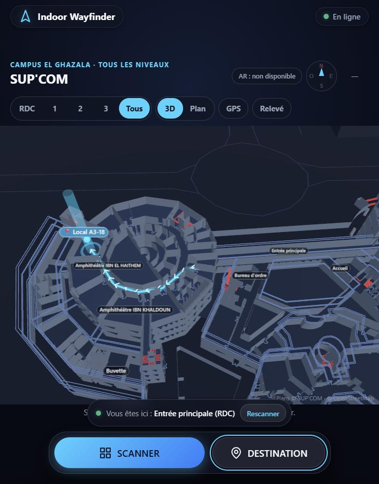
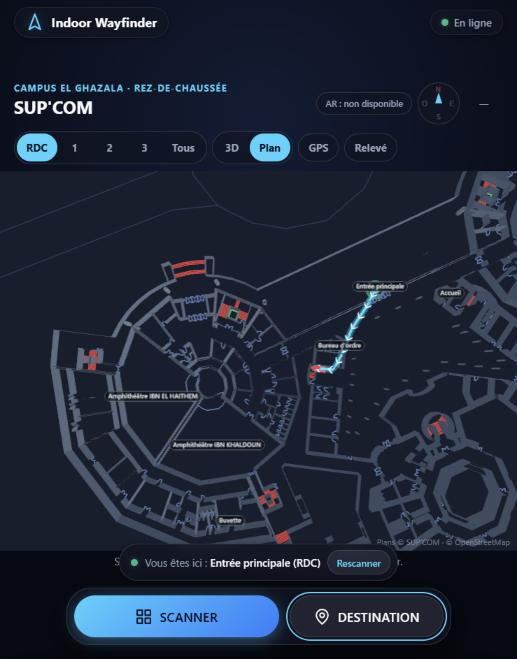
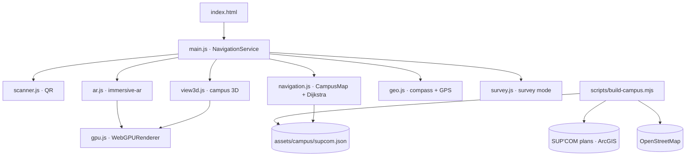

# Indoor Wayfinder — SUP'COM

> **AR indoor navigation for the real SUP'COM building, in the browser.** Scan a QR code on the wall (or use GPS outside), pick any room on any of the four floors, and follow the route in 3D (WebGPU) and on the floor through your phone camera (WebXR), oriented by the compass.

**SUP'COM — Département SIA** · Project 2: *WebXR AR & Spatial Computing*

| | |
|---|---|
| **Team** | Yassine Mhiri · Oussema Harrabi · Amin Jarbaoui |
| **Supervisor** | Mohamed-Becha Kaâniche |
| **Brief** | Cahier des charges v1.0 — 24 October 2026 (scope extended by the supervisor: whole SUP'COM building, floors, compass, GPS, WebGPU) |
| **Docs** | [Technical](docs/technical.md) · [User manual](docs/user-manual.md) · [Design notebook](docs/design-notebook.md) · [Changelog](CHANGELOG.md) · [Attribution](ATTRIBUTION.md) |
| **Live demo** | [indoor-wayfinder-lyart.vercel.app](https://indoor-wayfinder-lyart.vercel.app) |
| **App version** | `v3.0.0` |
| **Last updated** | 2026-11-12 |

---

## What it does

1. **Real building data.** The app loads SUP'COM's own floor plans: walls, doors, stairs, lifts and columns of the ground floor and floors 1–3. These come from the public ArcGIS layer that powered the old [supnav.supcom.tn](https://supnav.supcom.tn). The surrounding El Ghazala buildings come from OpenStreetMap.
2. **Every room, every floor.** 233 rooms are detected automatically from the plans, each with a stable code (`A1-07`). The four amphitheatres, the reception, the *bureau d'ordre* and the *buvette* carry their official names. A survey mode lets the team type in the names written on the doors.
3. **Where am I?** You can locate yourself in four ways:
   - scan a QR code on the wall;
   - pick a start point in the list;
   - tap the plan;
   - outdoors, use GPS.
4. **Route.** Dijkstra runs on a 25 cm walkable grid covering all four floors. Stairs and lifts connect the floors, and a "no stairs" strategy uses lifts only. Steps are in French with compass directions, for example "Marchez 22 m vers le Sud-Ouest" or "Prenez l'escalier (Bloc A) jusqu'à l'étage 3".
5. **3D view (WebGPU).** All four floors are stacked, with a floor selector, a plan view (north up), an animated route, a destination beacon, your position, your heading and the GPS fix.
6. **AR guidance (WebXR on WebGPU).** Hit testing finds the real floor. The compass aligns the AR world with true north, so the floor chevrons follow the actual route and the anchored arrow points down the real corridor.




## WebGPU only

All 3D is rendered by Three.js **r187** `WebGPURenderer` on the **WebGPU** backend, and the app's code creates no WebGL context.
- **Renderer creation:** `src/gpu.js` creates a renderer only when `navigator.gpu` returns an adapter, and rejects any non-WebGPU backend.
- **AR session:** requested with the `webgpu` session feature, so Three.js renders it through `XRGPUBinding`.

> **Phone prerequisite for AR:** Chrome has not yet enabled the WebXR/WebGPU binding by default ([Chrome Platform Status](https://chromestatus.com/feature/5077077997649920)). On the demo phone, open `chrome://flags/#webxr-webgpu-binding`, set it to **Enabled**, and restart Chrome. You also need Google Play Services for AR. Without the flag, the 3D view and routes work, and the AR button explains what is missing.

## About SupNav

[supnav.supcom.tn](https://supnav.supcom.tn) was SUP'COM's earlier navigation site: a React app with an Esri ArcGIS map.
- **Why it is broken:** it now shows *"Error importing Data"* because its own web service `supws/SupcomServices.svc/getPlacesPersons` (the room and office database) returns HTTP 400.
- **What still works:** the floor plans are still published on ArcGIS Online, and Indoor Wayfinder imports them (`scripts/build-campus.mjs`).
- **What was lost:** the room names stored in that database.

## Run it

```bash
node --test scripts/test-navigation.mjs   # 13 tests: campus, routing, strategies, compass
python -m http.server 8000                # http://localhost:8000 (HTTPS needed on the phone)
node scripts/build-campus.mjs             # re-import the SUP'COM plans + OpenStreetMap
```

Deploy (HTTPS):

```bash
vercel --prod --yes
```

## Architecture



| File | Role |
|---|---|
| `src/main.js` | Controller / facade: state, UI, scanner, route panel, AR, compass, GPS, survey |
| `src/navigation.js` | `CampusMap`, `CampusRouter` (Dijkstra, strategies), turn-by-turn steps |
| `src/view3d.js` | `CampusView3D`: WebGPU 3D campus, floors, route, markers, touch controls |
| `src/ar.js` | `ARGuide`: immersive-ar on WebGPU, hit test, anchor, compass-aligned arrow and trail |
| `src/gpu.js` | WebGPU detection and `WebGPURenderer` factory |
| `src/geo.js` | `Compass` (DeviceOrientation), `GpsTracker` (Geolocation) |
| `src/survey.js` | `SurveyStore`: room names and missing passages → `corrections.json` |
| `src/scanner.js` | Camera QR scanning (BarcodeDetector / jsQR) |
| `scripts/build-campus.mjs` | Imports and processes the plans into `assets/campus/supcom.json` |
| `sw.js` | Offline cache (shell, campus data, Three.js r187) |

## QR codes

Each QR code encodes a place id: `ENTREE_PRINCIPALE`, `ACCUEIL`, `AMPHI_KHAWAREZMI`, `ESCALIER_A`, `ASCENSEUR_B`, or a room code such as `B1-07`.
- **Ready-made cards:** [`docs/qr-codes/`](docs/qr-codes/).
- **Printable board for every room of a floor:** [`docs/qr-codes.html`](docs/qr-codes.html).
- **Deep link:** `?depart=ENTREE_PRINCIPALE&destination=A3-18`.

## Verified

- **Node tests:** 13/13. They cover:
  - every official place reachable from every other one;
  - all 241 places routed from the entrance, with doorless rooms flagged;
  - 3rd-floor routes going through stairs or a lift;
  - the lifts-only strategy;
  - French steps with compass bearings;
  - the compass heading maths.
- **Chrome 152 (WebGPU):**
  - the 3D campus renders (`renderer WebGPU: true`);
  - Entrée principale → A3-18 = 71 m, 1 floor change, through the Bloc A stairs;
  - floor tabs, plan view, survey mode (naming A0-35 and undo).
- **Simulated WebXR device** with `XRGPUBinding` backed by real GPU textures:
  - a `webgpu` + `hit-test` session starts on a real tap and frames render;
  - a tap anchors the arrow at 208°, the real south-west corridor bearing;
  - "Quitter AR" restores the UI.
- **QR cards:** all 15 decode with the app's decoder.

## Not verified yet / known limits

- **AR on the Samsung S23** with the WebXR/WebGPU flag is not tested on the device yet.
- **25 ground-floor rooms with no doorway on the plan:** the outer rings of Blocs A and B, including the *buvette*, have no door in the CAD plan. Routes stop at the nearest connected point and say "Accès à confirmer". Fix this with a surveyed passage.
- **Room names:** apart from the official labels, rooms show their code until the survey mode names them.
- **Compass accuracy indoors:** about ±15° near steel structures. Rescanning a QR code re-anchors the route.

## Team

Yassine Mhiri · Oussema Harrabi · Amin Jarbaoui — supervised by Mohamed-Becha Kaâniche.
