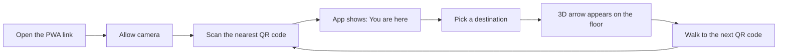
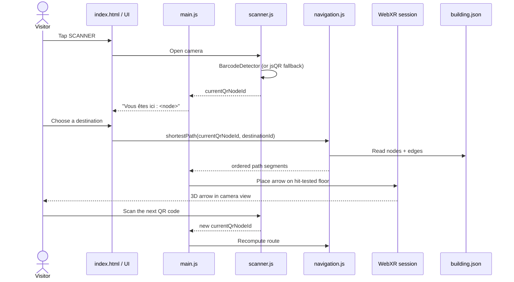
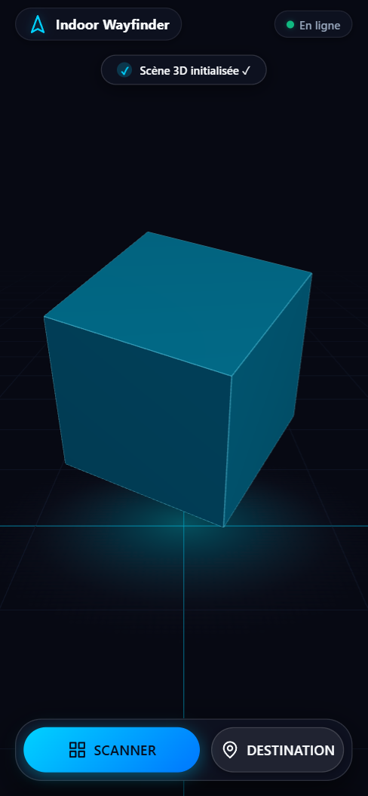
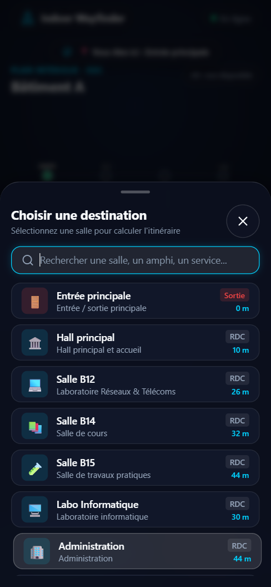
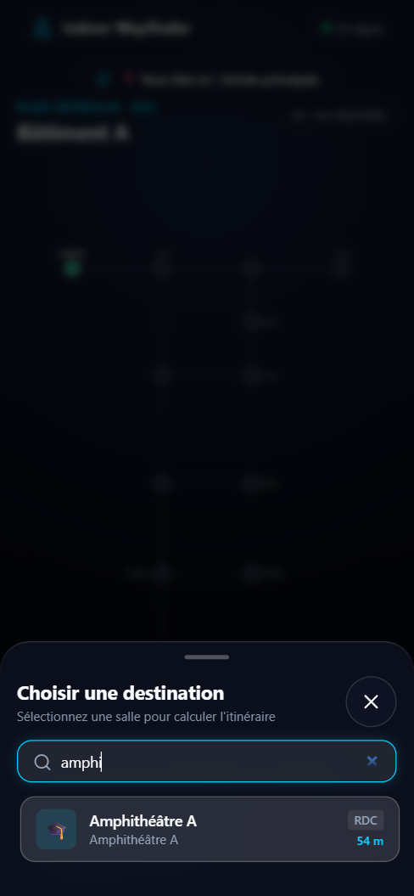
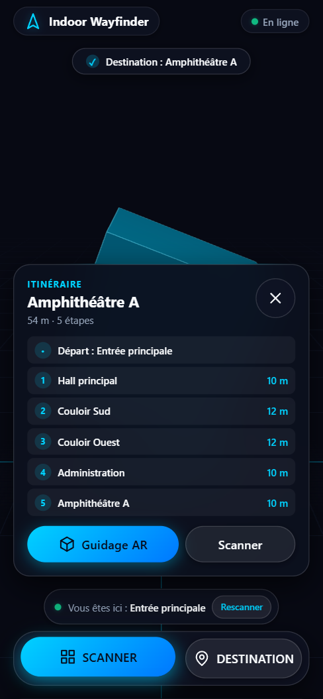
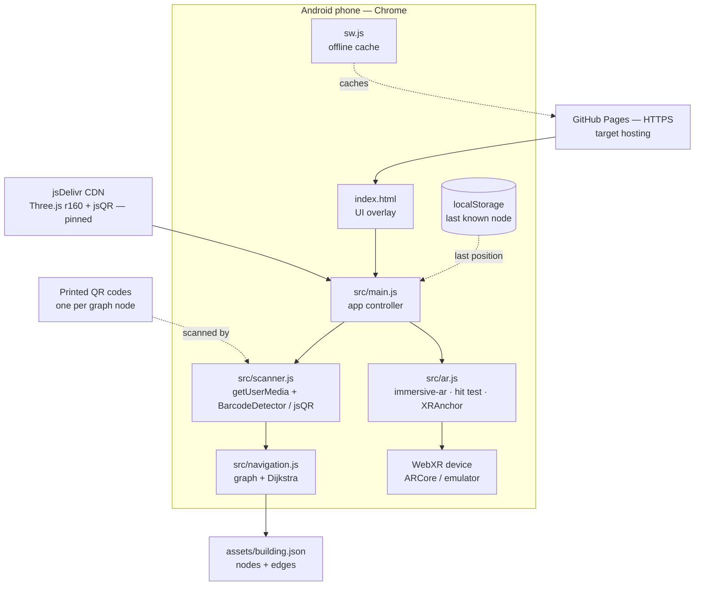

# Indoor Wayfinder

> **AR indoor navigation, in the browser.** Scan a QR code on the wall, pick a room, and follow a 3D arrow drawn on the floor through your phone camera.

**SUP'COM — Département SIA** · Project 2: *WebXR AR & Spatial Computing* · 6-week MVP

| | |
|---|---|
| **Team** | Yassine Mhiri · Oussema Harrabi · Amin Jarbaoui |
| **Supervisor** | Mohamed-Becha Kaâniche |
| **Brief** | Cahier des charges v1.0 — 24 October 2026 |
| **Changelog** | [CHANGELOG.md](CHANGELOG.md) |
| **Docs** | [Technical](docs/technical.md) · [User manual](docs/user-manual.md) · [Design notebook](docs/design-notebook.md) |
| **Live demo** | [indoor-wayfinder-lyart.vercel.app](https://indoor-wayfinder-lyart.vercel.app) — HTTPS preview deployed from `main` |
| **App version** | `v2.3.0` (Sprint 4 + interactive plan + 3D route view) |
| **Sprint** | Sprints 1–3 complete; interactive demo + Sprint 4 code |
| **Last updated** | 2026-11-12 |

---

## Table of contents

1. [The project in one minute](#the-project-in-one-minute)
2. [The problem](#the-problem)
3. [How it works](#how-it-works)
4. [Screenshots](#screenshots)
5. [What is already built](#what-is-already-built)
6. [What is not built yet](#what-is-not-built-yet)
7. [Project status](#project-status)
8. [Architecture](#architecture)
9. [Technology stack](#technology-stack)
10. [Repository layout](#repository-layout)
11. [Run it locally](#run-it-locally)
12. [Deployment](#deployment)
13. [Building data model](#building-data-model)
14. [Roadmap — the remaining five sprints](#roadmap--the-remaining-five-sprints)
15. [Design patterns](#design-patterns)
16. [Coding conventions](#coding-conventions)
17. [Deliverables checklist](#deliverables-checklist)
18. [Demo scenario](#demo-scenario)
19. [Testing environment](#testing-environment)
20. [Risks and mitigations](#risks-and-mitigations)
21. [Out of scope](#out-of-scope)
22. [FAQ](#faq)
23. [Team](#team)

---

## The project in one minute

Large buildings are hard to navigate. Wall maps are static, GPS does not work indoors, and installing a native app just to find a room is too much friction.

**Indoor Wayfinder is a Progressive Web App (PWA)** that turns an Android phone into an indoor GPS:

1. The visitor opens a **web link** — nothing to install.
2. They **scan a QR code** posted in the corridor, so the app knows which point of the building they are standing at.
3. They **choose a destination** (room, amphitheatre, exit).
4. The app computes the **shortest path** through the building graph.
5. Through the camera, a **3D arrow appears on the floor** and points the way (WebXR augmented reality).
6. At the next QR code, the visitor scans again and the route updates.

The whole stack is **client-side only**: static files on GitHub Pages, Three.js from a pinned jsDelivr CDN, a JSON floor plan, and the phone's camera. No server, no beacons, no budget.

---

## The problem

> *How can a visitor know where they are inside a building and follow a route displayed in their real environment, without installing an app and without expensive infrastructure (Bluetooth beacons, sensor networks)?*

Constraints imposed by the course:

- **6 weeks**, one sprint per week, demo every week.
- **No budget and no dedicated hardware**.
- Target: **Android smartphone** (Chrome) or a **desktop emulator**.
- **HTTPS is mandatory** for camera access, WebXR and the Service Worker.
- The building plan is entered **manually** as a graph; no automatic mapping.
- **No GPS indoors**; localization relies only on QR codes.
- **One floor** in the first version (no stairs/elevators in routing).

Target users: students, newcomers, visitors and exam candidates; secondary users: building administrations that want complementary signage; evaluators: the jury and teachers.

---

## How it works

### User journey



### Technical flow



**Important:** the position is **not continuous**. It is updated only when a QR code is scanned. Between two codes, the app keeps the last known node and the arrow guides toward the next waypoint. This is a deliberate design choice from the brief, not a bug.

---

## Screenshots

Captured on **2026-11-11** from v2.2.2 at a 390 × 844 mobile viewport.

| Home — interactive floor plan | Scanner + QR fallback |
|:---:|:---:|
| <br>**Home** — real building graph, not a cube | <br>**Scanner** — camera + image upload |
| <br>**Destinations** — 9 nodes, real distances | <br>**Search** — live filtering |

**Real Dijkstra route, highlighted on the plan:**



The scanner screenshot uses a simulated camera feed in headless Chrome; the
upload button is the real desktop fallback. Distances and the cyan path come
from `assets/building.json` + Dijkstra, not hard-coded values.

---

## What is already built

Sprints 1–3 are complete; the Sprint 4 WebXR code is ready for device testing
and the home screen is a real interactive floor plan with a **2D / 3D** view
of the building and the route (**v2.3.0**).

### 1. Mobile-first PWA shell — `index.html`

- French UI, dark glassmorphism design system, safe areas and `100dvh`.
- Accessible dialogs: `inert` background, focus trap, `aria-expanded`, Escape,
  focus restoration; pinch zoom enabled; AA muted contrast.
- PWA icons, manifest and offline Service Worker.
- Running status toast, online/offline badge and persistent position chip.

### 2. Interactive floor plan — `index.html`, `main.js`

- SVG plan generated from `assets/building.json`: 12 nodes, 12 edges.
- Functionally labelled rooms and corridors; `AR : disponible/non disponible` badge.
- Click a node to simulate a QR position — explicitly labelled **Démo**.
- Dijkstra path highlighted in cyan; route panel with real distance and steps.
- QR image upload fallback for desktops without a camera.
- The Three.js canvas is hidden outside AR; no floating cube on the home screen.

### 3. Real QR scanner — `src/scanner.js`

- Rear camera via `getUserMedia`, native `BarcodeDetector`, jsQR fallback.
- One detection every 150 ms, 2 s cooldown per value, no overlapping decodes.
- Generation token cancels a pending camera start if the overlay closes during
  the permission prompt; camera tracks are always released.
- QR payload = graph node ID (`ENTREE`, `SALLE_B12`, …).

### 4. Building graph and real routing — `navigation.js`, `main.js`

- `assets/building.json`: 12 nodes, 12 weighted edges, one floor.
- Adjacency list + Dijkstra + `AvoidStairsStrategy` extension point.
- Destination sheet generated from the graph; every distance is computed.
- Route panel with total distance, ordered legs and per-leg distances.
- Position updates on each QR scan and recomputes the route immediately.
- Nine Node tests cover nodes, edges, paths, distances and reachability.

### 5. WebXR augmented reality — `src/ar.js`

- Support probe with `navigator.xr.isSessionSupported('immersive-ar')`.
- `requestSession` with `hit-test`, optional `anchors` and `dom-overlay`.
- `renderer.xr`, `local-floor`, transparent canvas, demo scene hidden.
- Reticle on the detected floor; tap to place the flat 1 m arrow.
- `XRAnchor` keeps the arrow stable; graceful fallback when unsupported.
- Start/stop AR controls and session cleanup.

### 6. What was verified (2026-11-11)

- Dijkstra: 9/9 Node tests pass; Salle B12 = 26 m, Amphi A = 54 m.
- Fake-camera integration: `ENTREE` QR → position chip → 9 graph destinations
  with real distances → Salle B12 route 26 m · 3 steps.
- QR image upload: `ENTREE` decoded on desktop → same position/route.
- Floor plan: 12 nodes, 12 edges, 9 labels, 3 highlighted route edges.
- Map click: HALL → Salle B12 recomputes to 16 m / 2 steps.
- AR unsupported path: clear message, no crash.
- Closed dialogs skipped by Tab, focus trapped, camera released on close.
- WebGL/CDN failure fallbacks, offline reload and manifest/icons still pass.

### 7. What was verified (2026-11-12, v2.3.0)

- **Any start, any end:** all 144 start/end pairs driven through the UI
  (**Départ** picker → destination list) match Dijkstra distance and step
  count; 11/11 Node tests, including the all-pairs test.
- All 12 QR cards in `docs/qr-codes/` decode with the app's `scanImage`.
- 3D route view: `ENTREE → SALLE_B12` 26 m, `AMPHI_A → LAB_INFO` 64 m,
  tap-to-position, rotate, 2D/3D toggle, AR → 3D fallback.

---

## What is not built yet

Honest state as of **2026-11-11**:

| Area | Status | Notes |
|---|---|---|
| QR scanner | ✅ Code ready | Fake-camera test passes; Android device test pending |
| Building graph + Dijkstra | ✅ Done | 12 nodes / 12 edges, 9 tests |
| Data-driven destinations | ✅ Done | No hard-coded rooms or fake distances |
| Route panel + recalculation | ✅ Done | Updates on every QR scan |
| Persistent position | ✅ Done | Chip above the action bar |
| WebXR `immersive-ar` | 🟡 Code ready | Hit test, anchor, arrow; real ARCore test pending |
| AR bearing calibration | ⬜ Sprint 5 | Arrow currently follows the phone's forward direction |
| Exit/re-enter AR to rescan | ⬜ Sprint 5 | UX flow to design |
| Arrival vibration / wake lock | ⬜ Sprint 5 | — |
| Service Worker / offline | ✅ Done | Versioned cache `v2.1.0` |
| PWA installability | ✅ Ready | Manifest + icons + Service Worker |
| Documentation | ✅ Done | Technical, user manual, design notebook |
| Attribution | ✅ Done | `ATTRIBUTION.md` updated 2026-11-11 |
| GitHub Pages deployment | ⬜ Not enabled | URL still returns 404 |
| Android/ARCore test | ⬜ Not documented | Required before the demo |
| Demo video | ⬜ Not started | Sprint 6 deliverable |
| Automated tests | ✅ Node | `node --test scripts/test-navigation.mjs` |

### Known issues

1. **No real Android/ARCore test is documented yet.** The camera, QR scanner and WebXR session are implemented, but they must be exercised on a phone before the demo.
2. **AR direction is not calibrated to building north.** The arrow points away from the phone at placement time; QR/compass calibration is Sprint 5.
3. **The AR camera ↔ QR scanner handoff needs a UX decision.** WebXR owns the camera during a session, so rescanning requires exiting AR.
4. **No HTTPS demo yet.** GitHub Pages is still disabled, so camera/WebXR cannot be tested from a public URL.
5. **PWA install has not been exercised on a real phone.** Install criteria are met locally.
6. **Arrival vibration and Screen Wake Lock are not implemented yet.** Planned Sprint 5.
7. **The 3D cube remains the non-AR demo object.** It is hidden automatically when the AR session starts.

---

## Project status

| Sprint | Goal | Expected deliverable | Status |
|---|---|---|---|
| **1** | PWA structure, Three.js scene, ES6 modules | A page that displays a 3D scene | ✅ **Done** |
| **2** | QR reading, position identification | “Vous êtes ici” + camera/jsQR | ✅ **Done** |
| **3** | Building graph, shortest path | Real route and distances | ✅ **Done** |
| **4** | `immersive-ar`, hit testing, arrow placement | 3D arrow anchored to the floor | 🟡 **Code ready; device test pending** |
| **5** | Route update on each QR scan, full journey | Complete journey on one floor | ⬜ Next |
| **6** | Offline, optimization, tests, docs, video | Final mobile version | 🟡 Offline/docs/tests done early |

**Progress:** Sprints 1–3 complete; Sprint 4 implemented and waiting for an
Android/ARCore run. Only the `main` branch is graded, so every sprint is merged
there through a reviewed pull request.

---

## Architecture

Everything runs **client-side**: no backend, no database, no user accounts, no personal data.



**Reading the diagram:** `scanner.js`, `navigation.js`, `building.json` and
`ar.js` are implemented. The AR session is code-complete but still needs an
Android/ARCore run. GitHub Pages remains the missing HTTPS host.

### Why this architecture

- **No install, no store:** a URL is enough; GitHub Pages provides HTTPS for free.
- **No infrastructure:** QR codes are printed paper, not powered beacons.
- **Works on low-end devices:** Three.js scene kept lightweight (2 lights, capped pixel ratio, procedural geometry).
- **Offline-friendly by design:** after the first load, the Service Worker serves the shell, icons and pinned Three.js module from cache; the building plan joins the cache when it exists.

---

## Technology stack

| Layer | Technology | Role | Status |
|---|---|---|---|
| Structure | HTML5 + CSS3 | PWA shell, responsive UI | ✅ |
| Logic | ES6 modules (`import`/`export`) | Modular code split | ✅ |
| 3D | Three.js **r160** via jsDelivr import map | Scene, camera, renderer, arrow geometry | ✅ Scene / 🟡 Arrow reserved |
| PWA | `manifest.json` + icons | Install metadata | ✅ |
| PWA | Service Worker (`sw.js`) | Offline cache, installability | ✅ |
| PWA | Offline app shell | Cached first load | ✅ Verified locally |
| Camera | `getUserMedia` | Rear camera stream | ✅ Code ready |
| QR | `BarcodeDetector` + **jsQR** fallback | Decode QR payloads | ✅ Code ready / fake-camera tested |
| AR | WebXR `immersive-ar`, hit testing, `XRAnchor` | Floor-anchored 3D arrow | 🟡 Code ready / device test pending |
| Routing | Dijkstra on a graph | Shortest path | ✅ 9 tests |
| Device | Vibration API, Screen Wake Lock | Arrival alert, screen stays on | 🟡 Vibration on QR; wake lock Sprint 5 |
| Hosting | GitHub Pages | HTTPS static deployment | ⬜ Not enabled |
| CDN | jsDelivr | Pinned Three.js + jsQR delivery | ✅ |

All libraries are loaded from **jsDelivr with pinned versions**, as required by the brief. No bundler, no npm build step: the repository is served as-is.

---

## Repository layout

### Current (verified)

```text
indoor-wayfinder/
├── index.html                 # PWA shell, UI overlay, design system
├── manifest.json              # PWA metadata (any + maskable icons)
├── sw.js                      # Offline app-shell service worker
├── package.json               # Test script, no runtime dependency
├── README.md
├── CHANGELOG.md
├── ATTRIBUTION.md
├── src/
│   ├── main.js                # Controller + UI + routing integration
│   ├── scanner.js             # Camera + BarcodeDetector/jsQR
│   ├── navigation.js          # Graph + Dijkstra + strategies
│   └── ar.js                  # immersive-ar + hit test + arrow
├── assets/
│   ├── building.json          # 12-node floor graph
│   └── icons/                 # 180/192/512 + maskable PNGs
├── docs/
│   ├── technical.md
│   ├── user-manual.md
│   ├── design-notebook.md
│   ├── qr-codes.html
│   └── screenshots/
└── scripts/
    └── test-navigation.mjs    # Node test suite
```

**Still planned:** an optional GLB arrow asset (the arrow is procedural) and the
5-minute demo video. The design notebook and the technical/user documentation
are now present.

---

## Run it locally

ES modules and the CDN import map do not work from `file://`. Serve the folder over HTTP:

```bash
git clone https://github.com/yessinomhiri-cpu/indoor-wayfinder.git
cd indoor-wayfinder
python -m http.server 8000
```

Open <http://localhost:8000>.

**Run the graph tests:**

```bash
node --test scripts/test-navigation.mjs
```

**What you should see:** the 3D scene, a live camera scanner, graph-generated
destinations, real Dijkstra distances, the route panel and the AR button.

**Demo QR codes:** `docs/qr-codes/demo-sheet.png` (ENTREE, HALL, COULOIR_EST, SALLE_B12) and individual PNGs. The test sequence is in `docs/qr-codes/README.md`.

**Offline check:** the Service Worker registers after load. Reload once so it controls the page, then switch DevTools to offline and reload; the shell and Three.js should still boot.

**Limits of this local test:**

- Camera and WebXR require a **secure context**. `http://localhost` counts as secure, but a LAN IP over HTTP does not.
- The public GitHub Pages URL would provide HTTPS; it is **not enabled yet**.
- Real `immersive-ar` testing needs **Android Chrome with ARCore**. Desktop Chrome can use the **Immersive Web Emulator** extension.
- A QR scan needs a printed/displayed code from `docs/qr-codes.html` or generated from a graph node ID.
- The AR session is code-complete but has not yet been validated on a physical ARCore device.

---

## Deployment

Target: **GitHub Pages**, static, HTTPS by default.

1. Repository **Settings → Pages**.
2. Source: **Deploy from a branch**.
3. Branch: `main`, folder: `/ (root)`.
4. Save; GitHub publishes to `https://<owner>.github.io/indoor-wayfinder/`.

**GitHub Pages state:** not enabled. The URL returns 404; enabling Pages is an admin action on the repository.

**Working HTTPS preview:** <https://indoor-wayfinder-lyart.vercel.app> — a static
deployment of the same `main` branch. Use it to test the camera and WebXR on an
Android phone while GitHub Pages is being enabled.

> HTTPS is not optional: Chrome refuses camera access and WebXR sessions on plain HTTP (except `localhost`).

---

## Building data model

> **Status: implemented in `assets/building.json` and consumed by `src/navigation.js`.**

The floor plan is a **weighted graph** stored as JSON:

- **Nodes** — QR markers in corridors, plus room/destination points. Coordinates in metres on the floor plane.
- **Edges** — walkable connections between nodes, with a distance (or travel cost).
- **Dijkstra** — computes the shortest path from the current QR node to the chosen destination.

Schema:

```json
{
  "building": {
    "name": "SUP'COM – Bâtiment A",
    "floor": "Rez-de-chaussée"
  },
  "nodes": {
    "ENTREE": { "name": "Entrée principale", "x": 0, "y": 0 },
    "HALL": { "name": "Hall principal", "x": 10, "y": 0 },
    "SALLE_B12": { "name": "Salle B12", "x": 20, "y": -6 }
  },
  "edges": [
    { "from": "ENTREE", "to": "HALL", "weight": 10 },
    { "from": "HALL", "to": "COULOIR_EST", "weight": 10 },
    { "from": "COULOIR_EST", "to": "SALLE_B12", "weight": 6 }
  ]
}
```

Design rules:

- The QR payload is the **node ID itself** (`ENTREE`, `SALLE_B12`, …).
- Every QR node must exist in `nodes` and map to exactly one graph node.
- Edges are **bidirectional**; `BuildingGraph` stores both directions.
- `weight` is the walking distance in metres.
- The first version covers **one floor**; multi-floor routing is explicitly out of scope.

QR generation:

```bash
# Example with qrencode; any QR generator works
qrencode -o SALLE_B12.png -s 8 -m 2 "SALLE_B12"
```

Print at a fixed height, one per corridor node, and record each node's position in the JSON.

---

## Roadmap — delivered and next

### Sprint 2 — QR localization ✅

**Goal:** the app knows where the visitor is.

- `src/scanner.js`: rear camera, `BarcodeDetector` + jsQR fallback.
- QR payload mapped to the graph node; persistent position chip.
- Permission errors, unknown QR and camera cleanup handled.
- Detection throttled and protected against start/stop races.

**Acceptance:** scanned QR updates the position; unsupported browsers use jsQR. **Verified with a fake camera; phone test pending.**

### Sprint 3 — Building graph and shortest path ✅

**Goal:** the app can compute a route.

- `assets/building.json`: 12 nodes, 12 weighted edges.
- `src/navigation.js`: adjacency list + Dijkstra + Strategy.
- Destination sheet generated from the graph; no hard-coded distances.
- Route panel with total distance and ordered legs.
- Nine Node tests.

**Acceptance:** correct ordered path and distance; unreachable routes handled. **Verified.**

### Sprint 4 — WebXR augmented reality 🟡

**Goal:** the arrow lives on the real floor.

- `navigator.xr.isSessionSupported('immersive-ar')` check.
- Session with `hit-test`; connected to `renderer.xr` and `local-floor`.
- Floor reticle and tap-to-place `XRAnchor`.
- Flat 1 m arrow, demo objects hidden, scene restored on exit.
- Unsupported-device fallback and start/stop controls.

**Acceptance:** on Android/ARCore, the arrow appears on the floor. **Code ready; physical device test pending.**

### Sprint 5 — Full navigation loop

**Goal:** a complete journey on one floor.

- ✅ Recompute the route after every QR scan.
- ✅ Connect destination selection to the graph and route panel.
- 🟡 Keep the last known position; add a clearer rescan flow.
- ⬜ Calibrate the AR arrow to the building (QR orientation or compass).
- ⬜ Design the AR ↔ QR camera handoff (exit AR to scan, then re-enter).
- ⬜ Screen Wake Lock and arrival vibration.

**Acceptance:** a tester walks a one-floor route with at least two QR scans; the route and arrow update after each scan.

### Sprint 6 — Polish and delivery

**Goal:** shippable MVP and documentation.

- Offline shell, icons and docs are already shipped.
- Verify installability on a real Android launcher.
- Performance pass on a mid-range Android phone.
- Physical Android/ARCore test of the QR + hit-test + anchor flow.
- Record the **5-minute demo video** with voice-over and title slide.
- Final tests and jury demo rehearsal.

**Acceptance:** after a first online load, the app opens offline; Lighthouse PWA checks pass; all deliverables from the brief exist.

---

## Design patterns

The four patterns required by the brief are now present.

| Pattern | Role in this project | Where it lives | Status |
|---|---|---|---|
| **Observer** | QR detection notifies the controller, which updates position/route/UI | `QrScanner.onDetect` → `main.js` | ✅ |
| **Strategy** | Swappable routing algorithms | `ShortestPathStrategy`, `AvoidStairsStrategy` | ✅ |
| **Facade** | Hides JSON/adjacency and WebXR complexity | `BuildingGraph`, `ARGuide` | ✅ |
| **Command** | Encapsulates user actions: scan, choose, recompute, start/stop AR | `main.js` handlers | ✅ |

---

## Coding conventions

From the brief, enforced on every file:

- **File header:** module name, team name, main author, creation date, last modification date, version number.
- **Block comments:** one for each HTML/CSS block and each JavaScript function.
- **Explicit names:** `currentQrNodeId`, `shortestPathSegments`, `arrowAnchor` — no cryptic abbreviations.
- **ES6 modules** with `import`/`export`; no global script soup.
- **No build step**: the repo must run as served.
- **Commit discipline:** one commit per functional step, explicit message, every push leaves a usable app.
- **Pinned dependency versions** — never `latest` from the CDN.

The existing `index.html` and `main.js` already follow the header-comment convention.

---

## Deliverables checklist

From the cahier des charges:

| # | Deliverable | Status |
|---|---|---|
| 1 | Design notebook with UML sequence, component and deployment diagrams | ✅ `docs/design-notebook.md` |
| 2 | `index.html` — PWA structure | ✅ |
| 3 | `src/main.js` — entry point, WebXR + Three.js, ES6 modules | ✅ |
| 4 | `src/scanner.js` — QR reading | ✅ |
| 5 | `src/navigation.js` — building graph + shortest path | ✅ |
| 6 | `manifest.json` — PWA configuration | ✅ |
| 7 | `sw.js` — Service Worker | ✅ |
| 8 | `/assets` — 3D arrow model + building plan JSON | 🟡 Plan + icons done; arrow is procedural, no GLB |
| 9 | Technical documentation (install, QR generation, deployment) | ✅ `docs/technical.md` |
| 10 | User manual (step-by-step guide) | ✅ `docs/user-manual.md` |
| 11 | Demo video, 5 minutes max, voice-over, no background music | ⬜ Sprint 6 |
| 12 | GitHub Pages deployment with HTTPS | ⬜ Owner action required |

---

## Demo scenario

The final jury demo, exactly as specified:

1. The user opens the PWA HTTPS link on an Android phone (Chrome).
2. They accept camera access.
3. They scan the nearest QR code in the corridor; the app shows **"Vous êtes ici"**.
4. They choose a destination from the list (for example **Salle B12**).
5. A 3D arrow appears on the floor. They tap the screen to place it, then follow the direction.
6. They reach the next QR code, scan it, and the position and route update.

**Test field:** one floor of the school building, with **6 to 8 printed QR codes**.

**Fallback environment:** Immersive Web Emulator on desktop Chrome, with a provided test plan.

---

## Testing environment

| Environment | Purpose | Status |
|---|---|---|
| Node 24 | Dijkstra, graph, distances | ✅ 9/9 tests |
| Desktop Chrome + local HTTP server | UI, scene, QR fake camera, routing | ✅ Verified |
| Desktop Chrome offline | Service Worker shell | ✅ Verified |
| Desktop Chrome + Immersive Web Emulator | WebXR dry runs without a phone | ⬜ Not set up |
| Android Chrome + ARCore | Mandatory real AR test | ⬜ Not tested |
| Printed QR codes in the school corridor | End-to-end journey | ⬜ Not produced |

**Manual checks that already pass:** QR `ENTREE` decoded with a fake camera, position chip updated, 9 graph destinations with real distances, Salle B12 route = 26 m / 3 steps, route recalculation on scan, AR unsupported fallback, focus trap, camera release on close, WebGL/CDN fallback, offline reload, valid manifest/icons.

**Required device APIs:** `getUserMedia`, `BarcodeDetector` (or jsQR), Vibration, Screen Wake Lock, WebXR. Camera and XR require **HTTPS or localhost**.

Useful references:

- WebXR device support and emulator: <https://immersiveweb.dev/>
- BarcodeDetector: <https://developer.mozilla.org/en-US/docs/Web/API/BarcodeDetector>
- jsQR fallback: <https://github.com/cozmo/jsQR>
- Three.js: <https://threejs.org/>
- GitHub Pages: <https://docs.github.com/en/pages>

---

## Risks and mitigations

| Risk | Impact | Mitigation |
|---|---|---|
| `BarcodeDetector` unsupported | No localization | jsQR fallback (implemented) |
| Hit testing unstable | Arrow will not sit on the floor | Reticle + `XRAnchor`; fallback message |
| AR direction not calibrated | Arrow points the wrong way | Sprint 5 calibration; for now it follows the phone's forward direction |
| Camera conflict between QR and AR | Cannot rescan during AR | Exit AR, scan, re-enter; UX to finalize |
| Position lost between QR codes | Wrong route | Keep the last known node; rescan |
| Mobile performance | Stuttering | Light geometry, capped pixel ratio, rendering paused under overlays |
| No HTTPS demo | Camera/XR impossible to test | Enable GitHub Pages before the session |
| Stale cached shell after deploy | Old UI or assets | Cache version bump + network-first navigation |

---

## Out of scope

Explicitly excluded from v1, per the brief:

- GPS positioning indoors — localization is QR-only.
- Automatic building mapping — the graph is entered manually.
- Stairs and elevators between floors — one floor only.
- App Store / Play Store publication — the product is a PWA.
- Personal data collection — no accounts, no tracking.
- iOS/WebXR support — the target is Android Chrome.

---

## FAQ

**Is this Google Maps for indoors?**
Conceptually yes, but without GPS and without a map: QR codes give discrete positions, and a 3D arrow gives the direction. It is closer to "indoor wayfinding with AR cues" than to a full indoor map.

**Why QR codes instead of Bluetooth beacons?**
Beacons cost money, need batteries and maintenance. Printed QR codes cost nothing, work offline and are precise enough to identify a corridor node.

**Why a PWA instead of a native app?**
No installation required, no store review, instant updates, one codebase, and it satisfies the course requirement (PWA + WebXR + Device APIs).

**Does the position update continuously?**
No. It updates when a QR code is scanned. Between codes, the last known node is kept and the arrow guides to the next waypoint.

**Does it work offline?**
Yes for the app shell: after the first controlled load, the Service Worker serves the shell, icons, Three.js, jsQR, the scanner/navigation/AR modules and `building.json` from cache.

**Which phones are supported?**
Android Chrome with ARCore is the reference. Desktop Chrome with the Immersive Web Emulator is the fallback. iOS is not a target for this MVP.

**Is my location or personal data collected?**
No. There is no backend, no account and no analytics. The last known node may be stored locally in the browser.

---

## Team

| Member | GitHub |
|---|---|
| Yassine Mhiri | [@yessinomhiri-cpu](https://github.com/yessinomhiri-cpu) |
| Oussema Harrabi | [@OussemaHarrabi](https://github.com/OussemaHarrabi) |
| Amin Jarbaoui | [@djarbouiamine](https://github.com/djarbouiamine) |

**Supervisor:** Mohamed-Becha Kaâniche — SUP'COM, Département SIA.

**Repository:** <https://github.com/yessinomhiri-cpu/indoor-wayfinder>

---

*Academic project — SUP'COM, Cycle Ingénieur SIA. Cahier des charges v1.0, 24 October 2026.*
