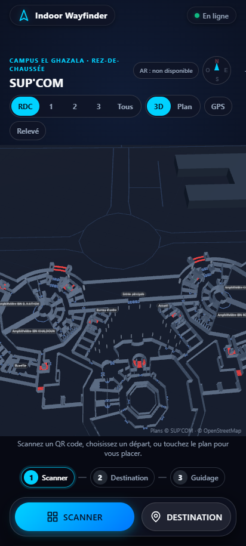
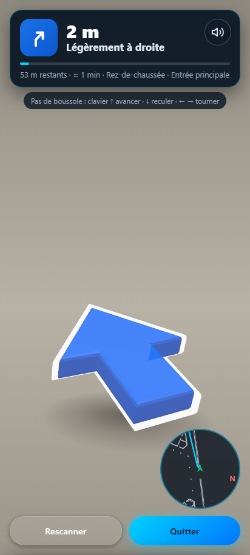
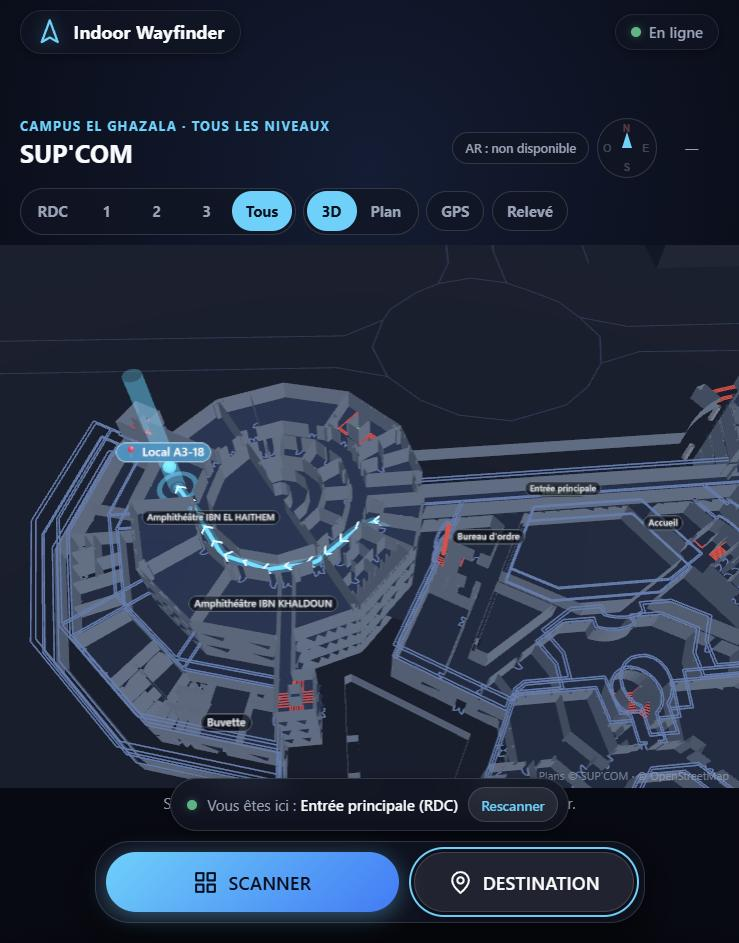
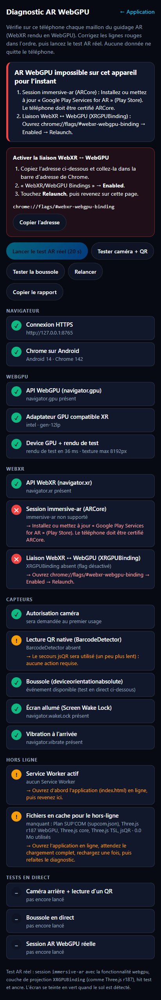
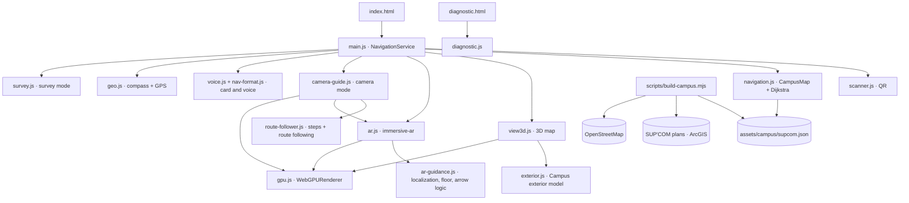

# Indoor Wayfinder — SUP'COM

> **Indoor navigation for the real SUP'COM building, in the browser.** Scan a QR code on the wall, pick any room on any of the four floors, and follow a big 3D arrow: in augmented reality on the floor (WebXR), or over the camera image on any Android phone. Spoken directions, offline, nothing to install.

**SUP'COM — Département SIA** · Project 2: *WebXR AR & Spatial Computing*

| | |
|---|---|
| **Team** | Yassine Mhiri · Oussema Harrabi · Amin Jarbaoui |
| **Supervisor** | Mohamed-Becha Kaâniche |
| **Brief** | Cahier des charges v1.0 — 24 October 2026 (scope extended by the supervisor: whole SUP'COM building, floors, compass, GPS, WebGPU) |
| **Repository** | [github.com/yessinomhiri-cpu/indoor-wayfinder](https://github.com/yessinomhiri-cpu/indoor-wayfinder) |
| **Docs** | [Technical](docs/technical.md) · [User manual](docs/user-manual.md) · [Demo phone setup](docs/demo-phone-setup.md) · [Design notebook](docs/design-notebook.md) · [Changelog](CHANGELOG.md) · [Attribution](ATTRIBUTION.md) |
| **Live demo** | [indoor-wayfinder-lyart.vercel.app](https://indoor-wayfinder-lyart.vercel.app) — v3.6.0, deployed 26 Nov 2026 |
| **App version** | `v3.7.0` |
| **Last updated** | 2026-11-26 |

---

## Use it in 3 steps

1. **Scanner** — scan the QR code on the nearest wall (or pick your start in the list, or tap the plan). The app shows « Vous êtes ici ».
2. **Destination** — search a room, an amphitheatre or a service; the route is computed over the four floors.
3. **Démarrer le guidage** — the app picks the best mode for the phone (chip **AR** or **CAMÉRA** on the button) and guides you with a big blue arrow, a Google Maps-style card and a voice.

The bar **① Scanner → ② Destination → ③ Guidage** at the bottom of the screen shows where you are.





## What it does

1. **Real building data.** The app loads SUP'COM's own floor plans: walls, doors, stairs, lifts and columns of the ground floor and floors 1–3. They come from the public ArcGIS layer behind the old [supnav.supcom.tn](https://supnav.supcom.tn); the surrounding El Ghazala buildings come from OpenStreetMap.
2. **Every room, every floor.** 233 rooms are detected automatically, each with a stable code (`A1-07`). The four amphitheatres, the reception, the *bureau d'ordre* and the *buvette* carry their official names. The **Relevé** (survey) mode lets the team type in the names written on the doors.
3. **Where am I?** Scan a QR code, pick a start point in the list, tap the plan, or use GPS outdoors.
4. **Route.** Dijkstra on a 25 cm walkable grid covering the four floors; stairs and lifts connect them, and the *Sans escaliers* strategy uses lifts only. French steps with compass directions (« Marchez 22 m vers le Sud-Ouest »).
5. **3D map (WebGPU).** Four stacked floors, floor selector, plan view (north up), animated route, destination beacon, position and heading. A frame budget keeps the GPU almost idle when nothing moves. **Campus** shows a daylight exterior model of SUP'COM built from the real floor outlines and modelled after the official SUP'COM 3D video: white towers with tall glazing, steel columns under a grey crown, the glazed entrance wing with the SUP'COM sign, the white arch over the entrance steps, flags, forecourt, palms, trees and sun shadows (`src/exterior.js`, procedural textures only).
6. **Two guidance modes, one button.**
   - **AR mode (WebXR on WebGPU)** — the QR scan fixes the start, ARCore tracks every step, and the walked path is **map-matched to the real walls**. Chevrons flow on the floor, real walls hide the guidance behind them, the route is recalculated when you leave it, floors change on the stairs. If ARCore finds no floor after 3 s, the guidance continues at an estimated floor height and a tap places the arrow 1.5 m ahead.
   - **Camera mode (any Android phone)** — no ARCore and no Chrome flag needed. The camera image fills the screen and the 3D arrow is drawn on top; the **compass** turns it towards the route and the **step counter** moves you along the route (0.7 m per step). At the stairs, « Je suis à l'étage N » continues on the next floor. If the AR session is refused, the app switches to this mode by itself.
7. **Floating guide arrow (both modes).** A big 3D arrow 2 m ahead at chest height that always points along the route: **blue** to follow, **grey** while the position is calibrating, **orange** off route, **green pointing down** at arrival. It leans into the turns and has a soft shadow.
8. **Guidance card and voice.** Turn icon, distance in large type, short action, progress bar, « 42 m restants · ≈ 1 min ». A French voice announces each turn about 12 m before and again at 3 m, with a vibration (🔊/🔇 to mute).
9. **Offline.** After a first full load, the Service Worker serves the app, the campus plan and the pinned libraries without network.
10. **Phone diagnostic.** `diagnostic.html` (tap the **AR : …** badge) checks every link of the WebGPU AR chain on the phone and runs a 20-second real AR test.

## WebGPU only

All 3D is rendered by Three.js **r187** `WebGPURenderer` on the **WebGPU** backend (supervisor requirement); the app's code creates no WebGL context.
- **Renderer creation:** `src/gpu.js` creates a renderer only when `navigator.gpu` returns an adapter, and rejects any non-WebGPU backend.
- **AR session:** requested with the `webgpu` session feature, rendered through `XRGPUBinding`.
- **Camera mode:** a transparent `WebGPURenderer` canvas over the camera video.

> **Phone prerequisite for the AR mode:** Chrome does not enable the WebXR/WebGPU binding by default yet ([Chrome Platform Status](https://chromestatus.com/feature/5077077997649920)). Open `chrome://flags/#webxr-webgpu-binding`, set it to **Enabled**, restart Chrome, and install Google Play Services for AR. Without it, the button starts the camera mode. Full procedure: [docs/demo-phone-setup.md](docs/demo-phone-setup.md).



## Run it

```bash
npm test                                  # 68 tests (Node, no browser needed)
python -m http.server 8000                # http://localhost:8000 (HTTPS needed on the phone)
node scripts/build-campus.mjs             # re-import the SUP'COM plans + OpenStreetMap
```

**Test on a computer without a phone:** open `http://localhost:8000/?depart=ENTREE_PRINCIPALE&destination=AMPHI_IBN_KHALDOUN`, click **Démarrer le guidage**, allow the webcam, then walk with the keyboard: **↑** step forward, **↓** step back, **← →** turn, **Esc** quit. To test the QR scan without a camera: **Scanner → Importer une image QR** with a file from `docs/qr-codes/`.

**Deploy (HTTPS):**

```bash
npx vercel --prod --yes                   # Vercel (after `npx vercel login`)
```

or push to GitHub and enable **GitHub Pages** (Settings → Pages → branch `main`, folder `/`), as required by the brief. After changing a cached file, bump `CACHE_NAME` in `sw.js`.

## Architecture



| File | Role |
|---|---|
| `src/main.js` | Controller / facade: state, UI, 3-step bar, route panel, guidance start (AR or camera), card and voice, compass, GPS, survey |
| `src/navigation.js` | `CampusMap`, `CampusRouter` (Dijkstra, strategies), turn-by-turn steps |
| `src/view3d.js` | `CampusView3D`: WebGPU 3D campus, floors, route, markers, touch controls, frame budget, day / night palette |
| `src/exterior.js` | `CampusExterior`: daylight SUP'COM exterior (façades from the floor outlines, crown, columns, arch, sign, flags, landscape, sky, sun) |
| `src/exterior-textures.js` | Procedural canvas textures of the exterior (tower bay, curtain wall, paving, sign, flag) |
| `src/ar.js` | `ARGuide`: immersive-ar on WebGPU, hit test, anchors, chevrons, wall occluders, floating guide arrow |
| `src/ar-guidance.js` | `ARGuidance` (live localization, map matching), `FloorEstimator`, guide arrow modes |
| `src/camera-guide.js` | `CameraGuide`: camera mode (video + WebGPU arrow, compass, step counter, keyboard test) |
| `src/route-follower.js` | `StepDetector`, `RouteFollower`: steps along the route, instructions, floor changes |
| `src/voice.js` | `VoiceAnnouncer` (what to say and when), `Voice` (speechSynthesis fr-FR) |
| `src/nav-format.js` | Guidance card: distance / action / icon, remaining distance |
| `src/gpu.js` | WebGPU detection and `WebGPURenderer` factory |
| `src/geo.js` | `Compass` (DeviceOrientation), `GpsTracker` (Geolocation) |
| `src/survey.js` | `SurveyStore`: room names and missing passages → `corrections.json` |
| `src/scanner.js` | Camera QR scanning (BarcodeDetector / jsQR) and QR image import |
| `src/diagnostic.js` | Phone readiness checks and the real AR session test (`diagnostic.html`) |
| `scripts/build-campus.mjs` | Imports and processes the plans into `assets/campus/supcom.json` |
| `sw.js` | Offline cache (shell, campus data, Three.js r187); never reloads a page during guidance |

**Design patterns (cahier §8.2):** Observer (position, compass, GPS and guidance listeners refresh the UI), Strategy (`ShortestPathStrategy` / `AvoidStairsStrategy`), Facade (`main.js` as `NavigationService` over scanner, router, 3D view, AR and camera modes).

## QR codes

Each QR code encodes a place id: `ENTREE_PRINCIPALE`, `ACCUEIL`, `AMPHI_KHAWAREZMI`, `ESCALIER_A`, `ASCENSEUR_B`, or a room code such as `B1-07`.
- **Ready-made cards:** [`docs/qr-codes/`](docs/qr-codes/).
- **Printable board for every room of a floor:** [`docs/qr-codes.html`](docs/qr-codes.html).
- **Deep link:** `?depart=ENTREE_PRINCIPALE&destination=A3-18`.

## Verified

- **Node tests: 68/68** (`npm test`):
  - campus and routing: every official place reachable, all 241 places routed from the entrance, 3rd-floor routes through stairs or a lift, lifts-only strategy, French steps, compass maths;
  - AR guidance: 12 simulated walks with an unknown AR yaw and a biased compass (mean error < 0.6 m), floor fallback, the blue arrow within 25° of the true route direction;
  - camera mode: step counting on simulated walks and shaking, the Entrée → Amphi IBN KHALDOUN walk with a ±15° compass, stairs to the 3rd floor;
  - voice: one announcement per turn (12 m, then 3 m), stairs and arrival once, « Faites demi-tour » at most every 8 s;
  - diagnostic verdicts;
  - exterior data: floor outlines (orientation, footprint, stacking) and the forecourt around the entrance.
- **Campus view (Chrome, WebGPU):** exterior model with sun shadows, compared with the official SUP'COM video; floor tabs and the 3D / Plan buttons return to the interior.
- **Chrome (WebGPU), full app with the Service Worker:** 3D map, 3-step bar, single guidance button, camera guidance with the card, mini-map and arrow (keyboard walk), offline cache of the 5 critical files.
- **Simulated ARCore device** whose `XRGPUBinding` returns real GPU textures: AR session, frames, floor found / not found, anchors, refused session.
- **QR cards:** all 15 decode with the app's decoder.

## Not verified yet / known limits

- **On a real phone:** AR on the Samsung S23 (with the flag), the camera mode's step length and step sensitivity, compass accuracy indoors, the voice and the vibrations. To do during the test session at SUP'COM ([docs/demo-phone-setup.md](docs/demo-phone-setup.md)).
- **Room names:** apart from the official labels, rooms show their code until the survey mode names them.
- **25 ground-floor rooms with no doorway on the plan** (outer rings of Blocs A and B, including the *buvette*): routes stop at the nearest connected point with « Accès à confirmer ». Fix with a surveyed passage.
- **Compass indoors:** about ±15° near steel structures; rescanning a QR code re-anchors the position.
- **Camera mode** assumes the user follows the route (no wall map matching); the next QR code corrects any drift.

## Team

Yassine Mhiri · Oussema Harrabi · Amin Jarbaoui — supervised by Mohamed-Becha Kaâniche.
