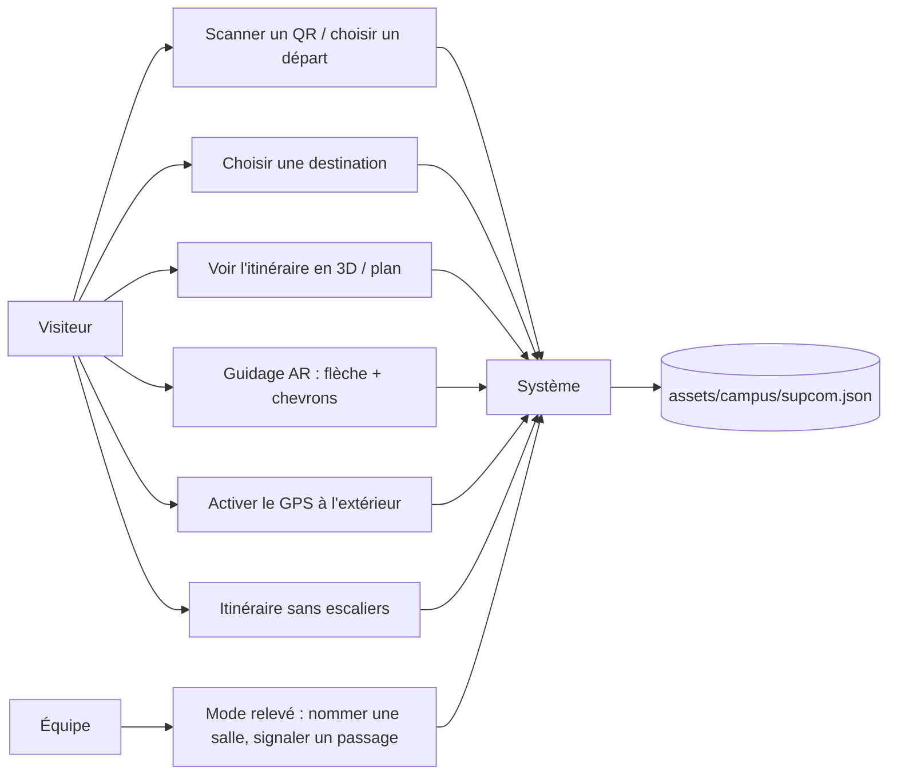
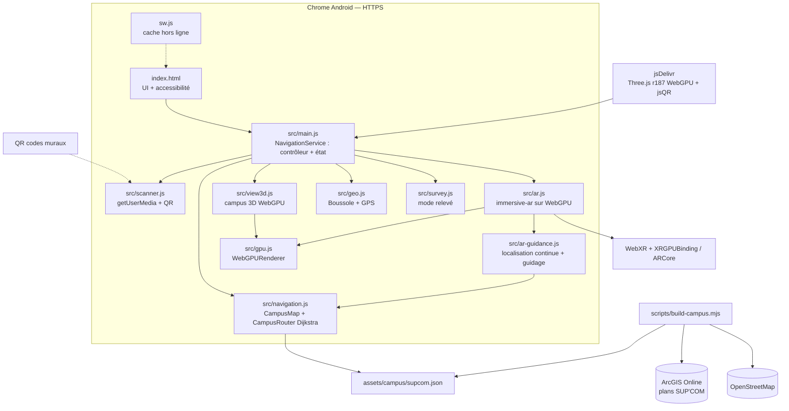
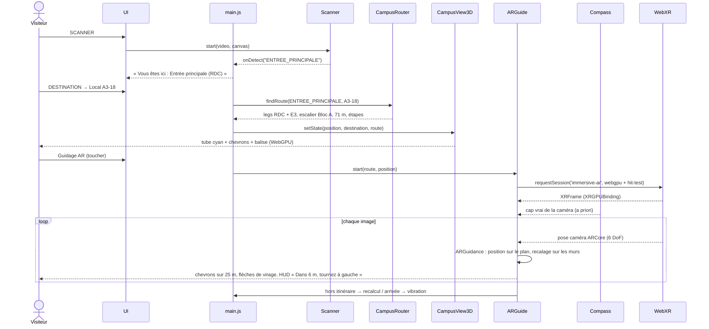
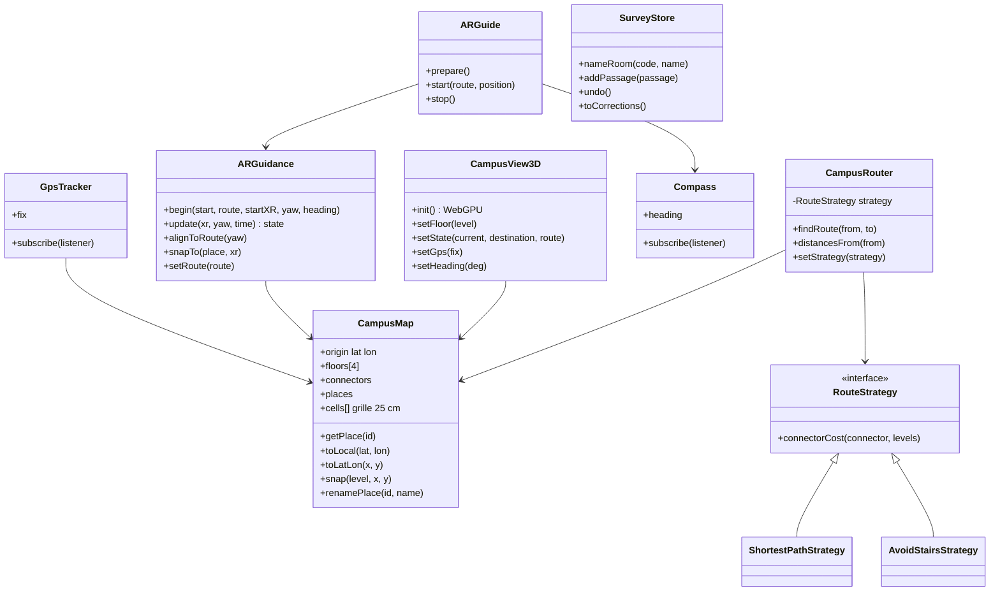
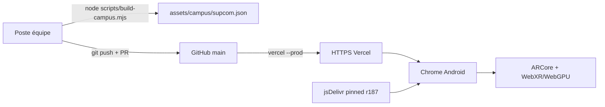

# Design notebook — Indoor Wayfinder

**Version :** 3.1.0
**Cahier des charges :** v1.0 — 24 octobre 2026 (périmètre élargi à la demande du superviseur : campus SUP'COM complet, plusieurs étages, boussole, GPS extérieur, rendu WebGPU)
**Équipe :** Yassine Mhiri, Oussema Harrabi, Amin Jarbaoui

## 1. Concept et acteurs

**Problème :** dans le bâtiment de SUP'COM (trois blocs circulaires A, B, C, un
hall central et quatre niveaux), un visiteur ne sait pas où il est et perd du
temps à chercher une salle. Les plans muraux sont statiques et le GPS ne
fonctionne pas à l'intérieur.

**Solution :** une PWA qui charge les **vrais plans de SUP'COM**, localise le
visiteur par QR codes (GPS à l'extérieur), calcule un itinéraire multi-étages
avec Dijkstra et le montre en 3D (WebGPU) puis au sol en réalité augmentée
(WebXR), orienté par la boussole.

| Acteur | Besoin |
|---|---|
| Visiteur, étudiant, candidat | Savoir où il est, trouver une salle, un amphi, une sortie |
| Administration | Signalisation complémentaire sans infrastructure |
| Équipe (relevé) | Nommer les salles et corriger les passages absents du plan |
| Jury / enseignant | Démonstration réelle dans le bâtiment |
| Système | Scanner, campus, routage, rendu WebGPU, session AR, capteurs |

## 2. Cas d'utilisation

## 3. Architecture composants

## 4. Séquence — du scan à la flèche orientée

## 5. Modèle de données

**Place** : `{ id, code, name, kind (amphi|room|place|stairs|lift), level, x, y, area, bbox, block, official }`.
**Connector** : `{ id, kind, name, x, y, levels[] }` — un escalier relie deux
niveaux consécutifs, un ascenseur tous les niveaux qu'il dessert.

## 6. Déploiement

## 7. Patrons de conception

| Patron | Usage |
|---|---|
| **Observer** | `QrScanner.onDetect`, `Compass.subscribe`, `GpsTracker.subscribe`, `SurveyStore.subscribe` notifient `main.js` ; chaque changement de position rafraîchit l'itinéraire, la vue 3D et les distances |
| **Strategy** | `ShortestPathStrategy` / `AvoidStairsStrategy` fixent le coût des escaliers et ascenseurs |
| **Facade** | `main.js` (NavigationService) masque scanner, campus, routeur, vue 3D et AR ; `ARGuide` masque WebXR ; `gpu.js` masque la création WebGPU |
| **Command** | Actions du mode relevé annulables (`SurveyStore.undo`) ; actions UI : destination, rescanner, AR |

## 8. Choix techniques

- **Plans réels** : la couche publique ArcGIS de SUP'COM (celle de l'ancien
  SupNav) fournit murs, portes, escaliers et ascenseurs des 4 niveaux ;
  OpenStreetMap fournit les bâtiments voisins. Le script d'import produit un
  seul JSON hors ligne.
- **Grille plutôt que graphe dessiné à la main** : 25 cm, portes ouvertes à
  partir des symboles de porte ; Dijkstra (tas binaire, heuristique A*
  optionnelle) sur les cellules de tous les étages, arêtes verticales =
  escaliers / ascenseurs. Les salles sont les régions fermées par murs et portes.
- **WebGPU uniquement** : `WebGPURenderer` (Three.js r187) pour la vue 3D et
  pour l'AR (fonctionnalité de session `webgpu`, `XRGPUBinding`). Aucun
  renderer n'est créé sans adaptateur WebGPU. La liaison WebXR/WebGPU est
  encore derrière `chrome://flags/#webxr-webgpu-binding` dans Chrome.
- **Boussole** : cap de la caméra arrière via la matrice DeviceOrientation,
  déclinaison +3,5° ; le décalage entre le nord et le monde AR oriente flèche
  et chevrons selon le cap réel du couloir.
- **GPS seulement dehors** : précision 5–30 m, inutilisable entre deux
  couloirs ; à l'intérieur, les QR codes restent la référence.
- **Cache-first pour les assets, network-first pour la navigation**.

## 9. Plan de test

| Test | Attendu |
|---|---|
| Campus | 13 tests Node : données, amphis ≈ 310 m², alias QR, GPS aller-retour |
| Routage | toutes les paires de lieux officiels, tous les lieux depuis l'entrée, étage 3 via escalier, sans escaliers = ascenseur |
| Étapes | consignes en français avec caps (Nord, Sud-Ouest…) |
| Boussole | cap téléphone debout nord / est, téléphone à plat |
| QR | 15 cartes décodées par l'application |
| Vue 3D | WebGPU actif, 4 étages, sélecteur, vue Plan, toucher = position |
| AR (simulateur) | session `webgpu` + `hit-test`, images rendues, ancre, sortie |
| Guidage AR | 12 marches simulées (`scripts/test-guidance.mjs`) : erreur moyenne < 0,6 m malgré une boussole faussée de ±15°, escaliers, recalcul, demi-tour |
| AR (téléphone) | Samsung S23, Chrome + ARCore + flag WebXR/WebGPU — **à valider** |
| Hors ligne | shell, plan du campus et Three.js r187 après un premier chargement |

## 10. Risques et mitigation

| Risque | Mitigation |
|---|---|
| Liaison WebXR/WebGPU non publiée dans Chrome | Flag documenté ; message clair et vue 3D WebGPU en repli |
| Portes absentes du plan CAD | Itinéraire jusqu'au point le plus proche + « accès à confirmer » ; passages relevés dans `corrections.json` |
| Noms de salles inconnus | Codes stables `A1-07` ; mode relevé pour saisir les noms des plaques |
| Boussole perturbée (acier, électronique) | Filtre, indicateur de fiabilité, conseil « faire un 8 », rescanner un QR |
| `BarcodeDetector` absent | Fallback jsQR |
| Performance mobile | Géométrie fusionnée par étage, rendu suspendu hors écran, pixel ratio ≤ 2 |

## 11. Répartition et planning

| Sprint | Objectif | État |
|---|---|---|
| 1 | Shell PWA, Three.js, accessibilité, offline | ✅ |
| 2 | Caméra, QR | ✅ |
| 3 | Destinations, itinéraire, distances | ✅ |
| 4 | Session `immersive-ar`, hit test, flèche | ✅ code, 🟡 test S23 |
| 5 | Campus SUP'COM réel, multi-étages, boussole, GPS, WebGPU | ✅ code, 🟡 relevé des noms sur place |
| 6 | Calibration sur site, docs, vidéo, soutenance | ⬜ |

## 12. Livrables

- Code sur `main` : `index.html`, `src/main.js`, `src/scanner.js`,
  `src/navigation.js`, `src/view3d.js`, `src/ar.js`, `src/gpu.js`,
  `src/geo.js`, `src/survey.js`, `sw.js`, `manifest.json`, `assets/`,
  `scripts/build-campus.mjs`.
- `docs/technical.md`, `docs/user-manual.md`, ce design notebook.
- `ATTRIBUTION.md` à jour.
- Vidéo de démonstration de 5 minutes.
