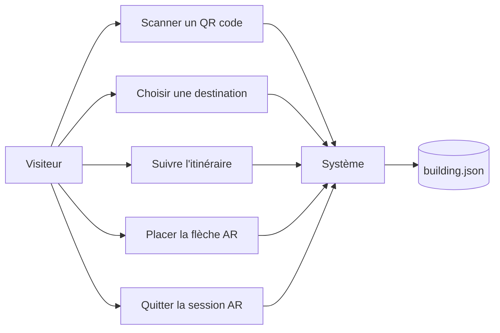
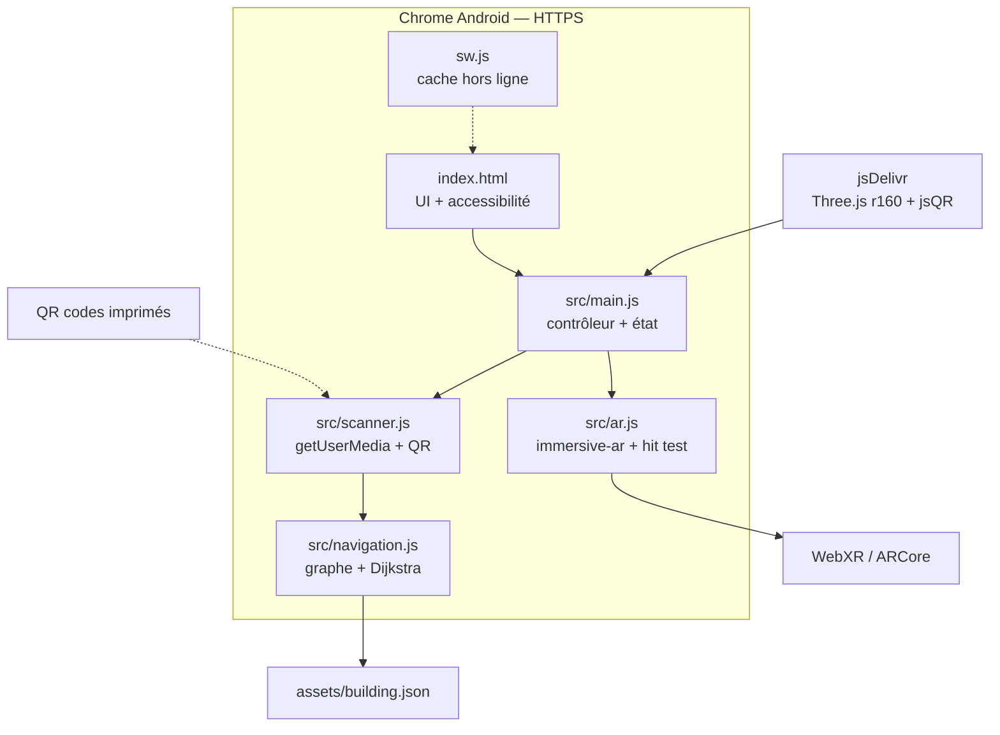
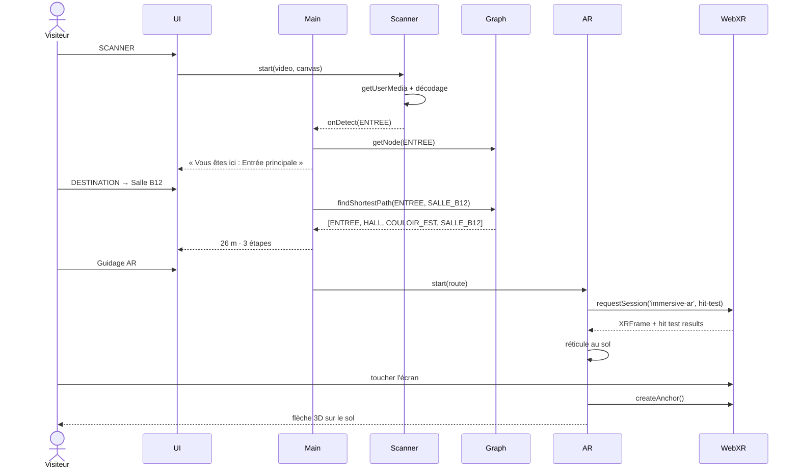
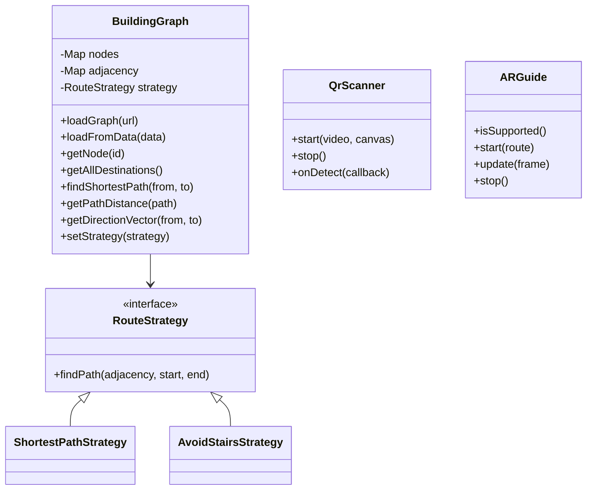
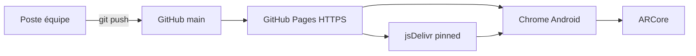

# Design notebook — Indoor Wayfinder

**Version :** 2.2.0
**Cahier des charges :** v1.0 — 24 octobre 2026
**Équipe :** Yassine Mhiri, Oussema Harrabi, Amin Jarbaoui

## 1. Concept et acteurs

**Problème :** dans un grand bâtiment, un visiteur ne sait pas où il est et perd
du temps à chercher une salle. Les plans muraux sont statiques et le GPS ne
fonctionne pas à l'intérieur.

**Solution :** une PWA qui localise le visiteur par QR codes, calcule un
itinéraire avec Dijkstra et affiche une flèche 3D sur le sol via WebXR.

| Acteur | Besoin |
|---|---|
| Visiteur | Savoir où il est, trouver une salle ou une sortie |
| Administration | Signalisation complémentaire, sans infrastructure |
| Jury / enseignant | Démonstration réelle sur un étage |
| Système | Scanner, graphe, routage, session AR |

## 2. Cas d'utilisation

## 3. Architecture composants

## 4. Séquence — du scan à la flèche

## 5. Modèle de données

## 6. Déploiement

## 7. Patrons de conception

| Patron | Usage |
|---|---|
| **Observer** | `QrScanner.onDetect` notifie `main.js` à chaque QR |
| **Strategy** | `ShortestPathStrategy` / `AvoidStairsStrategy` interchangeables |
| **Facade** | `BuildingGraph` masque le JSON et l'adjacence ; `ARGuide` masque WebXR |
| **Command** | Actions UI : choisir une destination, rescanner, démarrer/arrêter l'AR |

## 8. Choix techniques

- **QR plutôt que balises** : zéro coût, zéro batterie, précision suffisante
  pour identifier un nœud de couloir.
- **Dijkstra** : graphe pondéré non orienté, poids = mètres, complexité
  acceptable pour 12–100 nœuds.
- **Three.js + WebXR** : Three.js rend la flèche, WebXR fournit le suivi et le
  hit test. `renderer.setAnimationLoop` est obligatoire pour les frames XR.
- **Cache-first pour les assets, network-first pour la navigation** : mise à
  jour du shell sans servir une vieille page hors ligne.
- **PWA** : pas de store, HTTPS fourni par GitHub Pages, mode avion après
  le premier chargement.

## 9. Plan de test

| Test | Attendu |
|---|---|
| Graphe | 9 tests Node : chemins, distances, arêtes, accessibilité |
| QR valide | `ENTREE` → pastille de position |
| QR inconnu | Message d'erreur, caméra active |
| Destination | 9 destinations issues du graphe, distances réelles |
| Itinéraire | 26 m / 3 étapes vers Salle B12 |
| AR supportée | réticule au sol, flèche ancrée |
| AR non supportée | message explicite, pas de crash |
| Hors ligne | shell + Three.js démarrent après un premier chargement |
| Fermeture scanner | pistes caméra libérées, overlay fermé |

## 10. Risques et mitigation

| Risque | Mitigation |
|---|---|
| `BarcodeDetector` absent | Fallback jsQR |
| Hit test instable | Réticule + ancre, sinon pose au sol |
| Direction AR non calibrée | Sprint 5 : orientation QR / boussole |
| Performance mobile | Géométrie légère, pixel ratio ≤ 2, rendu suspendu sous les overlays |
| Cache obsolète | Version de cache `v2.2.0`, navigation network-first |
| Pages non actif | Activer Settings → Pages avant la démonstration |

## 11. Répartition et planning

| Sprint | Objectif | État |
|---|---|---|
| 1 | Shell PWA, Three.js, accessibilité, offline | ✅ |
| 2 | Caméra, QR, graphe, Dijkstra | ✅ |
| 3 | Destinations réelles, itinéraire, distances | ✅ |
| 4 | Session `immersive-ar`, hit test, flèche | 🟡 code prêt, test Android à faire |
| 5 | Recalibrage après QR, orientation, wake lock | ⬜ |
| 6 | Optimisation, docs, vidéo, soutenance | ⬜ |

## 12. Livrables

- Code sur `main` : `index.html`, `src/main.js`, `src/scanner.js`,
  `src/navigation.js`, `src/ar.js`, `sw.js`, `manifest.json`, `assets/`.
- `docs/technical.md`, `docs/user-manual.md`, ce design notebook.
- `ATTRIBUTION.md` à jour.
- Vidéo de démonstration de 5 minutes (Sprint 6).
